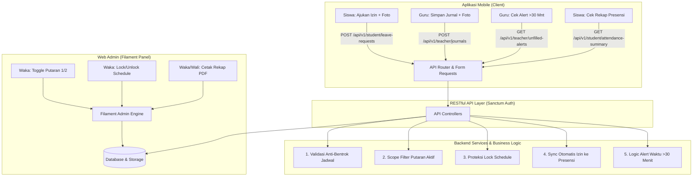

# 📱 ANALISIS KOMPARASI FITUR: MOBILE APP VS WEB DASHBOARD (FILAMENT)
## School Class Progress (SCP) — Uji Kompetensi Keahlian (UKK) 2026

> **Proyek:** School Class Progress (SCP) SMK  
> **Target Analisis:** Pemisahan & Klasifikasi Fitur (Mobile-First vs Web/Admin Portal)  
> **Arsitektur:** Hybrid Architecture (Laravel 13 Backend + Filament PHP Web Panel + Flutter/React Native REST API)  
> **Tujuan Dokumen:** Memberikan pedoman komprehensif mengenai fitur mana saja yang wajib/relevan diimplementasikan di aplikasi **Mobile**, mana yang khusus di **Web/Desktop**, dan mana yang berjalan secara **Hybrid** (keduanya), lengkap dengan justifikasi teknis, UX, dan rubrik penilaian UKK.

---

## 📑 DAFTAR ISI
1. [Latar Belakang & Filosofi Pemisahan Platform](#1-latar-belakang--filosofi-pemisahan-platform)
2. [Matriks Pemetaan Fitur Berdasarkan Role & Platform](#2-matriks-pemetaan-fitur-berdasarkan-role--platform)
3. [Bedah Analisis Mendalam Kategori Fitur](#3-bedah-analisis-mendalam-kategori-fitur)
   - [A. Fitur Prioritas Utama Mobile (Mobile-First / Mobile-Friendly)](#a-fitur-prioritas-utama-mobile-mobile-first--mobile-friendly)
   - [B. Fitur Khusus Web Panel / Desktop (Web-Only / Admin-First)](#b-fitur-khusus-web-panel--desktop-web-only--admin-first)
   - [C. Fitur Hybrid (Tersedia di Kedua Platform)](#c-fitur-hybrid-tersedia-di-kedua-platform)
4. [Justifikasi Teknis & Logika Bisnis (Kunci Penilaian UKK)](#4-justifikasi-teknis--logika-bisnis-kunci-penilaian-ukk)
5. [Pemetaan Endpoint REST API untuk Fitur Mobile](#5-pemetaan-endpoint-rest-api-untuk-fitur-mobile)
6. [Komparasi Pola Interaksi & UI/UX (Mobile vs Web)](#6-komparasi-pola-interaksi--uiux-mobile-vs-web)
7. [Panduan Menjawab Sesi Tanya Jawab Penguji UKK](#7-panduan-menjawab-sesi-tanya-jawab-penguji-ukk)
8. [Kesimpulan & Rekomendasi](#8-kesimpulan--rekomendasi)

---

## 1. LATAR BELAKANG & FILOSOFI PEMISAHAN PLATFORM

Dalam soal UKK 2026, sistem **School Class Progress (SCP)** dirancang dengan pendekatan **Mobile-First Design** untuk operasional lapangan, namun tetap membutuhkan **Web Backoffice** yang tangguh untuk tata kelola kurikulum dan master data.

```
┌────────────────────────────────────────────────────────────────────────┐
│                     BACKEND UTAMA (LARAVEL 13)                         │
│   PostgreSQL/MySQL Database + Business Logic + Sanctum Token Auth      │
└──────────────────┬─────────────────────────────────┬───────────────────┘
                   │                                 │
         (Blade & Livewire)                   (RESTful API v1)
                   │                                 │
                   ▼                                 ▼
    ┌─────────────────────────────┐   ┌─────────────────────────────┐
    │     WEB PANEL (FILAMENT)    │   │      APLIKASI MOBILE        │
    │  (Desktop / Tablet Admin)   │   │     (Android & iOS App)     │
    ├─────────────────────────────┤   ├─────────────────────────────┤
    │ • Waka Kurikulum            │   │ • Siswa & Orang Tua         │
    │ • Manajemen Master Data     │   │ • Guru (Di dalam Ruang PBM) │
    │ • Lock Schedule / Putaran   │   │ • Pengajuan Izin Instan     │
    │ • Export & Cetak Laporan    │   │ • Kamera Realtime Jurnal    │
    │ • Tim Kesiswaan / BK        │   │ • Quick Alert & Notifikasi  │
    └─────────────────────────────┘   └─────────────────────────────┘
```

### Mengapa Perlu Analisis Pemisahan Fitur?
1. **Konteks Penggunaan (User Context):**
   - **Guru di Kelas:** Bergerak aktif, memegang smartphone, membutuhkan waktu < 1 menit untuk mengambil foto dokumentasi PBM dan mencentang kehadiran siswa.
   - **Siswa/Orang Tua di Rumah:** Mengajukan surat sakit/izin mendadak langsung dari kamera smartphone.
   - **Waka Kurikulum di Ruang Tata Usaha:** Mengatur puluhan master jadwal, plotting ruangan, dan mencetak laporan resmi A4/F4 (membutuhkan keyboard, mouse, dan layar lebar).
2. **Efisiensi Performa & Payload:**
   - Aplikasi mobile tidak perlu mengunduh seluruh data relasi kelas, history audit, atau konfigurasi sistem yang tidak relevan.
3. **Pemanfaatan Fitur Native Perangkat Mobile:**
   - Akses kamera hardware langsung tanpa dialog browser file picker yang kaku.
   - Notifikasi lokal / push notification ketika jadwal mengajar selesai.

---

## 2. MATRIKS PEMETAAN FITUR BERDASARKAR ROLE & PLATFORM

Tabel berikut memetakan seluruh fitur sistem SCP ke dalam status ketersediaan di **Mobile App** dan **Web Panel**:

| No | Modul / Fitur Sistem | Target Role | Dipakai di Mobile? | Dipakai di Web? | Status Klasifikasi | Keterangan & Rationale |
|---|---|---|:---:|:---:|:---:|---|
| **1** | **Autentikasi & Session** | Semua Role | ✅ Ya | ✅ Ya | `HYBRID` | Mobile menggunakan Token Sanctum, Web menggunakan Filament Session Auth. |
| **2** | **Toggle Putaran Blok (1/2)** | Waka Kurikulum | ❌ Tidak | ✅ Ya | `WEB ONLY` | Konfigurasi strategis global 2 mingguan, dilakukan oleh Waka di meja kerja. |
| **3** | **Lock / Unlock Jadwal** | Waka Kurikulum | ❌ Tidak | ✅ Ya | `WEB ONLY` | Saklar keamanan global agar guru tidak dapat memanipulasi jadwal aktif. |
| **4** | **Master Ruangan & Kelas** | Waka / Admin | ❌ Tidak | ✅ Ya | `WEB ONLY` | Manajemen master data sekolah berorientasi tabel desktop. |
| **5** | **Manajemen User & Role** | Waka / Admin | ❌ Tidak | ✅ Ya | `WEB ONLY` | CRUD akun, reset password, dan pemetaan role user. |
| **6** | **Input/Edit Jadwal Guru** | Guru / Waka | ❌ Tidak *(Hanya Read)* | ✅ Ya | `WEB FIRST` | Input jadwal memerlukan form kompleks + validasi tabrakan ruang. Mobile cukup melihat jadwal. |
| **7** | **Lihat Jadwal Hari Ini (Siklus Aktif)** | Guru | ✅ Ya | ✅ Ya | `HYBRID` | Mobile menampilkan kartu timeline jadwal harian secara ringkas. |
| **8** | **Isi Jurnal Mengajar + Foto Realtime** | Guru | ✅ Ya *(Prioritas)* | ✅ Ya | `MOBILE FIRST` | Pengambilan foto dokumentasi kelas realtime langsung lewat kamera HP guru. |
| **9** | **Input Presensi Siswa Per Jurnal** | Guru | ✅ Ya *(Prioritas)* | ✅ Ya | `MOBILE FIRST` | Toggle status Hadir/Sakit/Izin/Alpa cepat untuk 36 siswa saat jam PBM berlangsung. |
| **10** | **Alert Terlambat Jurnal (>30 Mnt)** | Guru | ✅ Ya *(Prioritas)* | ✅ Ya | `MOBILE FIRST` | Alert visual/notifikasi instan di layar HP saat jam pelajaran usai. |
| **11** | **Pengajuan Izin/Sakit + Foto Surat** | Siswa / Ortu | ✅ Ya *(Prioritas)* | ✅ Ya | `MOBILE FIRST` | Siswa/Ortu memfoto surat dokter/surat izin orang tua dan langsung upload via HP. |
| **12** | **Monitoring Rekap Presensi Personal** | Siswa / Ortu | ✅ Ya | ✅ Ya | `HYBRID` | Grafik persentase kehadiran dan riwayat mapel yang diikuti. |
| **13** | **Verifikasi Izin (Approve/Reject)** | Wali Kelas & BK | ✅ Ya *(Quick Action)* | ✅ Ya | `HYBRID` | Mobile: swipe/tap review cepat; Web: tabel filter status lengkap. |
| **14** | **Rekap Presensi Seluruh Siswa Kelas** | Wali Kelas & BK | ⚠️ Opsional (Ringkas) | ✅ Ya *(Lengkap)* | `WEB FIRST` | Tampilan rekap tabular puluhan siswa lebih optimal di layar lebar. |
| **15** | **Export & Cetak Laporan Presensi (PDF)** | Waka, Wali Kelas, Guru | ❌ Tidak | ✅ Ya | `WEB ONLY` | Format cetak dokumen resmi (Kop Surat, Tanda Tangan, Layout A4/F4 Lanskap). |

---

## 3. BEDAH ANALISIS MENDALAM KATEGORI FITUR

---

### A. FITUR PRIORITAS UTAMA MOBILE (MOBILE-FIRST / MOBILE-FRIENDLY)

Fitur-fitur dalam kategori ini memiliki urgensi tertinggi untuk diakses via smartphone:

#### 1. Input Jurnal Harian & Presensi Kelas Real-Time (Guru)
- **Alasan Penggunaan di Mobile:**
  - Guru mengajar di laboratorium/bengkel tanpa selalu membawa laptop ke setiap meja siswa.
  - Membutuhkan integrasi **kamera native smartphone** untuk mengambil foto bukti PBM secara live.
  - UI dirancang berupa *Quick Toggle Chips* (Hadir, Sakit, Izin, Alpa) dengan auto-select default "Hadir" sehingga absensi 36 siswa selesai dalam 30 detik.
- **Logika Otomatisasi:**
  - Siswa yang sudah memiliki izin berstatus `Approved` pada hari tersebut otomatis terkunci sebagai `Izin`/`Sakit` dan tidak dapat diubah menjadi `Alpa`.

#### 2. Dashboard Visual Alert Guru — Reminder Keterlambatan Jurnal (Guru)
- **Alasan Penggunaan di Mobile:**
  - Guru langsung mengecek HP saat bel istirahat/pergantian jam berbunyi.
  - Jika waktu saat ini telah melewati `end_time + 30 menit` dan jurnal belum terisi, aplikasi mobile menampilkan banner merah menyala / pop-up peringatan:  
    `"⚠️ Anda belum mengisi Jurnal untuk kelas XII RPL 1 (Mapel: Web Mobile). Segera isi sekarang!"`

#### 3. Pengajuan Surat Izin/Sakit Mandiri (Siswa & Orang Tua)
- **Alasan Penggunaan di Mobile:**
  - Orang tua/siswa tidak perlu membuka komputer atau datang ke sekolah saat mendadak sakit di pagi hari.
  - Pengambilan foto surat keterangan dokter langsung dari galeri atau kamera HP.
  - Terdapat status badge dinamis (`Pending` 🟡, `Approved` 🟢, `Rejected` 🔴).

#### 4. Notifikasi & Monitoring Presensi Siswa (Orang Tua / Siswa)
- **Alasan Penggunaan di Mobile:**
  - Orang tua memantau apakah anaknya benar-benar hadir di setiap jam pelajaran secara real-time.
  - Menampilkan persentase kehadiran kumulatif dan rincian alpa.

#### 5. Quick Verification / Approval Surat Izin (Wali Kelas & Guru BK)
- **Alasan Penggunaan di Mobile:**
  - Wali kelas dapat memverifikasi surat izin siswa saat perjalanan ke sekolah atau di ruang guru cukup dengan 1 tap tombol `Setujui` atau `Tolak`.

---

### B. FITUR KHUSUS WEB PANEL / DESKTOP (WEB-ONLY / ADMIN-FIRST)

Fitur-fitur ini **TIDAK DIREKOMENDASIKAN** atau **TIDAK PERLU** dibuat di aplikasi Mobile:

#### 1. Toggle Saklar Putaran Blok (Putaran 1 & Putaran 2) — Waka Kurikulum
- **Mengapa Web-Only?**
  - Perubahan siklus 2-mingguan adalah kebijakan akademik institusi yang dilakukan berkala (bukan operasional menit demi menit).
  - Merubah siklus blok berdampak pada seluruh jadwal dan presensi sekolah. Harus dilakukan dengan teliti di dashboard admin Filament.

#### 2. Mekanisme Lock / Unlock Jadwal Mengajar — Waka Kurikulum
- **Mengapa Web-Only?**
  - Fitur penguncian massal jadwal dilakukan setelah masa penyusunan jadwal semester selesai.
  - Merupakan fungsi kontrol manajerial yang memerlukan konfirmasi dialog otorisasi tingkat tinggi.

#### 3. Master Data Ruangan, Kelas, dan Manajemen Pengguna
- **Mengapa Web-Only?**
  - Pengelolaan data tabular massal (impor data siswa, penambahan ruangan baru, konfigurasi password) membutuhkan layar lebar, pagination, search bar multi-kolom, dan bulk-actions yang tidak ergonomis di layar ponsel.

#### 4. Penyusunan & Pemetaan Jadwal Pelajaran (Schedule Builder)
- **Mengapa Web-First?**
  - Memilih kombinasi Guru + Kelas + Ruang + Hari + Jam Mulai + Jam Selesai + Putaran Blok memerlukan ketelitian tinggi.
  - Algoritma validasi anti-tabrakan waktu menampilkan pesan error spesifik yang lebih jelas dibaca di browser desktop.

#### 5. Modul Cetak Laporan Presensi Resmi & Printable View (PDF/Print View)
- **Mengapa Web-Only?**
  - Menghasilkan dokumen laporan presensi dengan layout standar dinas pendidikan (Kop Surat, tabel matriks tanggal 1-31, kolom rekap H/S/I/A, kolom persentase, dan tanda tangan Kepala Sekolah & Wali Kelas).
  - Printer fisik sekolah terhubung langsung ke PC / Jaringan LAN TU, bukan ke HP siswa/guru.

---

### C. FITUR HYBRID (TERSEDIA DI KEDUA PLATFORM)

Fitur-fitur ini tersedia di Mobile maupun Web, namun dengan presentasi UI yang berbeda:

| Fitur | Implementasi di Mobile App | Implementasi di Web Dashboard |
|---|---|---|
| **Login / Autentikasi** | Form simpel, Remember Me via Sanctum Token, Biometrik (opsional). | Form Filament Admin, session cookie berbasis web. |
| **Lihat Jadwal Mengajar** | Tampilan kartu harian (Daily Timeline Tab) sesuai siklus aktif. | Tampilan tabel lengkap mingguan dengan filter hari, kelas, dan siklus. |
| **Riwayat Presensi Siswa** | Card list interaktif dengan badge status warna-warni. | Tabel detail dengan filter tanggal, pencarian nama, dan sortir data. |
| **Review Pengajuan Izin** | Modal bottom-sheet dengan gambar preview lampiran yang bisa di-zoom. | Tabel Filament Resource dengan Action Button dan lightbox modal gambar. |

---

## 4. JUSTIFIKASI TEKNIS & LOGIKA BISNIS (KUNCI PENILAIAN UKK)

Berikut adalah landasan justifikasi teknis mengapa pembagian ini memenuhi standar industri dan kriteria kelulusan UKK:



### 1. Kepatuhan Terhadap 5 Logika Bisnis Inti UKK:
1. **Anti-Tabrakan Waktu (Conflict Prevention):** Dijalankan di backend saat validasi jadwal. Baik request dari Web maupun Mobile ditolak jika `(start_time < existing_end AND end_time > existing_start)`.
2. **Toggle Siklus Putaran:** Disimpan di tabel `system_configurations`. API mobile secara otomatis menyematkan scope `forActiveCycle()` sehingga guru mobile hanya menerima jadwal di putaran aktif.
3. **Lock Schedule:** Diatur oleh Waka via Web. Saat `is_schedule_locked = true`, API jadwal memblokir request POST/PUT/DELETE untuk guru.
4. **Sinkronisasi Izin Otomatis:** Saat guru men-submit jurnal via Mobile, controller backend otomatis memeriksa `leave_requests` siswa berstatus `Approved` dan mengisi `attendances` dengan status `Izin`/`Sakit`.
5. **Dashboard Alert Reminder (>30 Menit):** Endpoint `/api/v1/teacher/unfilled-alerts` menghitung selisih waktu `now() > schedule.end_time + 30 minutes` tanpa bergantung pada Cron Job sistem operasi.

---

## 5. PEMETAAN ENDPOINT REST API UNTUK FITUR MOBILE

Seluruh fitur mobile didukung oleh endpoint RESTful terstandarisasi berikut (sesuai dokumen `LANGKAH_STEP_12_REST_API_MOBILE.md`):

```
BASE_URL: https://domain-sekolah.sch.id/api/v1
```

### 🔐 1. Modul Autentikasi (`/auth`)
| Method | Endpoint | Fungsi Mobile | Auth? |
|---|---|---|:---:|
| `POST` | `/auth/login` | Login user (Siswa, Guru, Wali Kelas, BK) & terbitkan token Bearer | ❌ Publik |
| `GET` | `/auth/me` | Ambil profil user yang sedang login | 🔒 Bearer |
| `POST` | `/auth/logout` | Revoke token aktif saat logout | 🔒 Bearer |

### 👨‍🎓 2. Modul Siswa & Orang Tua (`/student`)
| Method | Endpoint | Fungsi Mobile | Auth? |
|---|---|---|:---:|
| `GET` | `/student/attendance-summary` | Ambil ringkasan statistik kehadiran (H/S/I/A) & riwayat 10 mapel terakhir | 🔒 Bearer |
| `GET` | `/student/leave-requests` | Ambil riwayat pengajuan surat izin/sakit siswa | 🔒 Bearer |
| `POST` | `/student/leave-requests` | Kirim formulir izin baru + upload foto surat dokter (Multipart) | 🔒 Bearer |

### 👨‍🏫 3. Modul Guru (`/teacher`)
| Method | Endpoint | Fungsi Mobile | Auth? |
|---|---|---|:---:|
| `GET` | `/teacher/schedules` | Ambil daftar jadwal mengajar guru pada siklus putaran aktif | 🔒 Bearer |
| `GET` | `/teacher/unfilled-alerts` | Cek jadwal hari ini yang terlewat >30 menit dan belum diisi jurnalnya | 🔒 Bearer |
| `POST` | `/teacher/journals` | Simpan jurnal harian + upload foto bukti PBM + input presensi sekelas | 🔒 Bearer |
| `GET` | `/teacher/classrooms/{id}/students` | Ambil daftar siswa suatu kelas untuk form absensi manual | 🔒 Bearer |

### 📋 4. Modul Verifikasi Tim Kesiswaan (`/kesiswaan`)
| Method | Endpoint | Fungsi Mobile | Auth? |
|---|---|---|:---:|
| `GET` | `/kesiswaan/leave-requests/pending` | Ambil daftar perizinan siswa yang menunggu persetujuan | 🔒 Bearer |
| `PATCH` | `/kesiswaan/leave-requests/{id}/status` | Eksekusi Approve atau Reject izin siswa | 🔒 Bearer |

### ⚙️ 5. Modul Global System (`/system`)
| Method | Endpoint | Fungsi Mobile | Auth? |
|---|---|---|:---:|
| `GET` | `/system/config` | Cek status siklus blok saat ini (Putaran 1/2) & status lock | ❌ Publik |

---

## 6. KOMPARASI POLA INTERAKSI & UI/UX (MOBILE VS WEB)

Perbandingan komponen antarmuka yang digunakan pada masing-masing platform:

```
┌──────────────────────────────────────┐     ┌────────────────────────────────────────────────────────────┐
│          MOBILE APP PATTERN          │     │                     WEB PANEL PATTERN                      │
├──────────────────────────────────────┤     ├────────────────────────────────────────────────────────────┤
│ • Bottom Navigation Bar              │     │ • Collapsible Left Sidebar Navigation                      │
│ • Pull-to-Refresh Gesture            │     │ • Header Breadcrumbs & Global Search                       │
│ • Floating Action Button (FAB)       │     │ • Multi-Column Filament Table Builder                      │
│ • Native Camera Intent / Image Picker│     │ • Drag & Drop File Upload Dropzone                         │
│ • Horizontal Date Strip / Carousel   │     │ • Date Range Picker & Multi-Select Filters                 │
│ • Swipe-to-Action (Approve/Reject)   │     │ • Modal Action Popups & Bulk Action Checkbox               │
│ • Toast / Snackbar Notification      │     │ • Dedicated Print Preview CSS Media Queries                │
└──────────────────────────────────────┘     └────────────────────────────────────────────────────────────┘
```

### Rincian Perbandingan Komponen:

| Fitur | Pola UI Mobile App | Pola UI Web Admin (Filament) |
|---|---|---|
| **Input Absensi Siswa** | Tampilan kartu list siswa dengan tombol chip segmen warna: `[Hadir]` (Hijau), `[Sakit]` (Kuning), `[Izin]` (Biru), `[Alpa]` (Merah). | Tabel Filament Repeater dengan dropdown select / radio inline per baris siswa. |
| **Unggah Bukti Foto Jurnal** | Tombol besar *"Buka Kamera"* yang langsung mentrigger kamera HP, dilengkapi kompresi gambar sebelum upload. | Komponen `FileUpload` Filament dengan drag-and-drop preview dan tombol browse file komputer. |
| **Alert Jurnal Terlewat** | Banner merah lengket (*Sticky Banner*) di bagian atas dashboard home + getar notifikasi. | Komponen `AlertWidget` Filament warna `danger` dengan ikon lonceng peringatan di dashboard. |
| **Pratinjau Surat Izin** | Pinch-to-zoom gambar di layar sentuh ponsel. | Lightbox modal pop-up resolusi tinggi di browser. |

---

## 7. PANDUAN MENJAWAB SESI TANYA JAWAB PENGUJI UKK

Saat sidang pengujian UKK, penguji sering menanyakan alasan arsitektural di balik pemilihan fitur. Berikut adalah panduan jawaban terbaik:

### ❓ Pertanyaan 1:
> *"Mengapa fitur manajemen jadwal dan konfigurasi putaran blok tidak dimasukkan ke dalam aplikasi Mobile?"*

**Jawaban Rekomendasi:**
> *"Pengaturan putaran blok (Putaran 1/2) dan penguncian jadwal (Lock Schedule) merupakan kewenangan administratif strategis Waka Kurikulum yang dilakukan secara berkala pada awal semester, bukan aktivitas operasional harian di kelas. Fitur tersebut membutuhkan kehati-hatian tinggi dan tampilan tabel jadwal yang kompleks untuk menghindari kesalahan input. Oleh karena itu, fitur ini dialokasikan pada Web Dashboard Admin (Filament) yang dilengkapi proteksi policy dan audit trail, sedangkan aplikasi Mobile difokuskan pada mobilitas operasional guru dan siswa (Mobile-First)."*

---

### ❓ Pertanyaan 2:
> *"Bagaimana aplikasi Mobile menangani integritas data jika Guru mengisi presensi tetapi siswanya sudah mengajukan izin yang di-approve Wali Kelas?"*

**Jawaban Rekomendasi:**
> *"Sistem kami menerapkan **Server-Side Automatic Sync Logic** pada transaksi penyimpanan jurnal (`DB::transaction`). Ketika Guru mengirim data presensi lewat Mobile, backend secara otomatis memvalidasi ke tabel `leave_requests`. Jika siswa tersebut tercatat memiliki izin berstatus `Approved` pada tanggal terkait, sistem secara otomatis menetapkan status kehadiran siswa sebagai `Izin` atau `Sakit` di tabel `attendances` dan mengabaikan status Alpa, sehingga data di Mobile dan Web selalu konsisten dan tidak terjadi anomali."*

---

### ❓ Pertanyaan 3:
> *"Mengapa Anda memisahkan autentikasi Web menggunakan Session Filament dan Mobile menggunakan Laravel Sanctum?"*

**Jawaban Rekomendasi:**
> *"Aplikasi Web Filament berjalan pada browser dengan arsitektur Stateful Session menggunakan cookie yang aman dari CSRF. Sedangkan aplikasi Mobile bersifat Stateless Client yang memerlukan Bearer Token (Laravel Sanctum 4.x). Sanctum sangat ringan, efisien dalam konsumsi bandwidth, dan memungkinkan pencabutan token secara instan (*revoke*) saat pengguna logout dari aplikasi mobile."*

---

### ❓ Pertanyaan 4:
> *"Bagaimana sistem memastikan foto jurnal yang diupload dari mobile tidak membuat storage server penuh?"*

**Jawaban Rekomendasi:**
> *"Pada Form Request API (`StoreJournalRequest`), kami menerapkan validasi ketat `mimes:jpg,jpeg,png` dengan batas maksimal ukuran file `max:3072` (3 MB). Di sisi client mobile, gambar dikompresi sebelum dikirim ke endpoint multipart, lalu disimpan di `storage/app/public/journal_photos` dengan nama berkas unik (hash name) untuk efisiensi penyimpanan dan pencegahan duplikasi."*

---

## 8. KESIMPULAN & REKOMENDASI

### 📌 Ringkasan Keputusan Desain:
1. **Fokus Mobile App:**
   - **Guru:** Pengisian jurnal harian, jepret foto kegiatan kelas realtime, absensi cepat siswa, dan menerima visual alert jadwal terlewat.
   - **Siswa / Orang Tua:** Pengajuan surat izin/sakit kilat dengan foto bukti, serta memantau rekap kehadiran harian.
   - **Wali Kelas / BK:** Verifikasi persetujuan izin secara cepat (quick action).
2. **Fokus Web Dashboard (Filament):**
   - **Waka Kurikulum / Admin:** Tata kelola master data (kelas, ruangan, user, roles), kontrol putaran blok 1/2, penguncian jadwal massal, dan pencetakan laporan resmi (PDF / Printable View).

### 🚀 Status Kesiapan Sistem:
- Backend Laravel 13 telah dilengkapi dengan **Filament Admin Panel** untuk Web Backoffice dan **Laravel Sanctum RESTful API (Step 12)** untuk konektivitas Aplikasi Mobile.
- Seluruh 5 Logika Bisnis Utama UKK telah terintegrasi dan terlindungi baik di layer Web Controller maupun API Controller.

---
*Dokumen ini dibuat sebagai bagian resmi dari arsip instruksi teknis Uji Kompetensi Keahlian (UKK) 2026 — Paket 3 Rekayasa Perangkat Lunak.*
