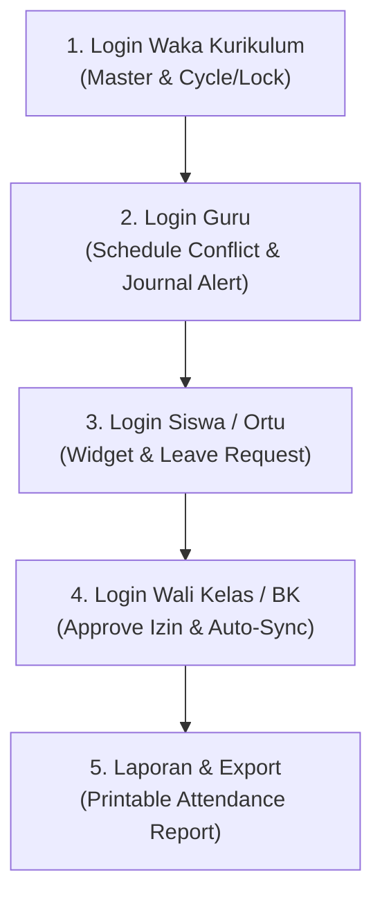

# PANDUAN PENGEMBANGAN: STEP 11 — PENGUJIAN AKHIR (FINAL TESTING), SKENARIO DEMO PENGUJI, & RUBRIK PENILAIAN UKK

> **Sistem:** School Class Progress (SCP) - UKK 2026  
> **Modul:** Final Testing Suite, Demo Script Presentasi UKK, Verification Checklist, & Rubrik Penilaian  
> **Target Pengguna:** Peserta UKK (Siswa), Penguji Internal, Penguji Eksternal, Guru Pembimbing  

---

## 🎯 TUJUAN STEP 11

Tahap 11 adalah tahap akhir operasional dan administrasi teknis dalam pengerjaan proyek Uji Kompetensi Keahlian (UKK) 2026 Paket 3 Rekayasa Perangkat Lunak (RPL). 

Tujuan utama dari Step 11 adalah:
1. **Verifikasi Integritas & Pembersihan Cache (Pre-Demo Setup):** Memastikan seluruh environment, migrasi database, seeder data, dan build asset berjalan 100% tanpa error sebelum pengujian oleh tim asesor.
2. **Panduan Skenario Demo Presentasi Depan Penguji (Demo Script):** Menyediakan urutan demonstrasi fitur yang sistematis untuk menunjukkan pemenuhan 5 Logika Bisnis Utama UKK di hadapan Penguji Internal dan Eksternal.
3. **Matriks Rubrik Penilaian UKK (Skor Maksimal 100):** Memberikan acuan pemetaan fitur SCP terhadap item-item lembar penilaian resmi UKK 2026 Paket 3.
4. **Troubleshooting & Emergency Recovery Guide:** Prosedur cepat mitigasi jika terjadi kesalahan teknis saat sesi demonstrasi langsung (live demo).

---

## 🛠️ BEDAH PENGEMBANGAN & PANDUAN STEP 11

---

### 📍 SUB-STEP 11.1: PRE-DEMO CHECKLIST & CLEANUP ENVIRONMENT

Sebelum mempresentasikan aplikasi di hadapan Penguji, lakukan langkah-langkah sterilisasi dan verifikasi berikut di workstation Anda:

#### 1. Jalankan Automated Testing Suite
Pastikan seluruh unit & feature test memenuhi kriteria 100% Passed:
```bash
php artisan test
```
*Target Result:* `5 passed (7 assertions)` tanpa ada failure atau error.

#### 2. Refresh Database & Seeder Data Resmi
Bereskan data uji coba temporer dan kembalikan ke kondisi data sampel seeder resmi:
```bash
php artisan migrate:fresh --seed
```

#### 3. Verifikasi Symlink Storage Asset
Pastikan direktori publik terhubung dengan storage untuk pengunggahan bukti foto jurnal dan surat izin:
```bash
php artisan storage:link
```

#### 4. Bersihkan Seluruh Cache Laravel & Filament
Hilangkan cache konfigurasi, route, dan view untuk mencegah ketidakcocokan state:
```bash
php artisan optimize:clear
```

#### 5. Jalankan Server Development & Asset Compiler
Buka 2 terminal terpisah untuk menjalankan backend Laravel dan frontend bundler (Vite):
```bash
# Terminal 1:
php artisan serve

# Terminal 2:
npm run dev
```
Akses antarmuka sistem melalui browser di: `http://localhost:8000/admin`

---

### 📍 SUB-STEP 11.2: SKENARIO DEMO PRESENTASI DEPAN PENGUJI (STEP-BY-STEP DEMO SCRIPT)

Gunakan alur demonstrasi 5-Tahap ini saat menyajikan aplikasi SCP di hadapan Penguji UKK:



---

#### 🎭 TAHAP 1: KONTROL WAKA KURIKULUM (`username: waka` | `password: password`)

1. **Buka Panel Admin & Login:** Login menggunakan akun `waka`.
2. **Demonstrasi Master Data & Role:**
   - Tunjukkan pengelolaan data **Kelas (`Classrooms`)**, **Ruangan (`Rooms`)**, dan **Pengguna (`Users`)**.
   - Tunjukkan arsitektur RBAC 6 Role yang terintegrasi.
3. **Demonstrasi Logika Utama #2 — Saklar Putaran Blok (Cycle Toggle):**
   - Buka menu **Konfigurasi Sistem (`System Configurations`)**.
   - Ubah status `active_cycle` dari **Putaran 1** ke **Putaran 2**.
   - Jelaskan ke Penguji bahwa perubahan ini secara global mengubah tampilan dan query jadwal mengajar guru di seluruh sistem.
4. **Demonstrasi Logika Utama #3 — Lock Schedule:**
   - Centang opsi `is_schedule_locked` menjadi `True` lalu simpan.
   - Jelaskan bahwa saat jadwal dikunci, Guru tidak dapat menambah, mengedit, atau menghapus jadwal secara mandiri.

---

#### 🎭 TAHAP 2: SIMULASI GURU & VALIDASI ANTI-BENTROK (`username: guru1` | `password: password`)

1. **Logout Waka & Login Guru:** Login menggunakan akun `guru1`.
2. **Pengujian Proteksi Lock Schedule:**
   - Buka menu **Jadwal Mengajar (`Schedules`)**.
   - Tunjukkan ke Penguji bahwa tombol **"Create Schedule"** dan aksi Edit/Delete tersembunyi karena Waka telah mengunci jadwal.
3. **Logout & Login Waka untuk Buka Kunci:** Buka kembali `is_schedule_locked = False` dari akun `waka`, lalu kembali ke akun `guru1`.
4. **Demonstrasi Logika Utama #1 — Validasi Anti-Tabrakan Waktu (Conflict Prevention):**
   - Buat Jadwal Mengajar baru pada hari **Senin**, Putaran 1, Jam 07:00 - 09:00 di Ruang Lab RPL 1.
   - Coba buat Jadwal kedua yang **bentrok/beririsan** (contoh: Jam 08:00 - 10:00 di Ruangan/Kelas/Guru yang sama).
   - Tunjukkan bahwa sistem **menolak secara otomatis** dan menampilkan pesan validasi error: *"Jadwal bentrok dengan jadwal mengajar lain..."*.
5. **Demonstrasi Logika Utama #5 — Dashboard Alert Reminder:**
   - Tunjukkan indikator peringatan visual di Dashboard jika terdapat jadwal mengajar guru yang telah selesai (>30 menit) namun Jurnal Mengajar belum terisi.
6. **Input Jurnal Mengajar + Foto Realtime:**
   - Buka menu **Jurnal Mengajar (`Journals`)**, buat jurnal baru, isi materi pembelajaran, dan unggah foto kegiatan pembelajaran.

---

#### 🎭 TAHAP 3: PORTAL SISWA & ORANG TUA (`username: siswa1` / `ortu1` | `password: password`)

1. **Login Siswa/Ortu:** Login menggunakan akun `siswa1` atau `ortu1`.
2. **Demonstrasi Widget Overview Kehadiran (Mobile-First UI):**
   - Tunjukkan widget visual persentase kehadiran, status Hadir/Sakit/Izin/Alpa, dan kartu riwayat presensi.
3. **Pengajuan Surat Izin / Sakit:**
   - Buka menu **Pengajuan Izin (`Leave Requests`)**.
   - Buat pengajuan surat izin untuk tanggal hari ini, pilih tipe (`Sakit` / `Izin`), beri alasan, dan unggah file bukti surat dokter/orang tua.
   - Status awal pengajuan adalah **`Pending`**.

---

#### 活 TAHAP 4: APPROVAL KESISWANAAN & SYNC OTOMATIS (`username: walikelas1` / `gurubk` | `password: password`)

1. **Login Wali Kelas / BK:** Login menggunakan akun `walikelas1` atau `gurubk`.
2. **Verifikasi Pengajuan Izin:**
   - Buka menu **Pengajuan Izin (`Leave Requests`)**.
   - Lihat lampiran dokumen bukti dari siswa, lalu ubah status menjadi **`Approved`**.
3. **Demonstrasi Logika Utama #4 — Alur Sync Perizinan Absensi Otomatis:**
   - Jelaskan ke Penguji bahwa saat Guru menginput Jurnal Mengajar hari ini, siswa yang izinnya telah berstatus `Approved` akan **otomatis terisi status `Izin/Sakit`** pada tabel presensi tanpa perlu diinput manual oleh Guru.

---

#### 🎭 TAHAP 5: LAPORAN REKAPITULASI PRESENSI & PRINTABLE PDF (`username: waka` / `walikelas1`)

1. **Buka Laporan Presensi:** Navigasi ke menu **Laporan & Rekap > Laporan Presensi**.
2. **Filter & Preview Data:** Pilih Kelas dan Rentang Tanggal, lalu klik filter untuk melihat rekap kehadiran siswa.
3. **Demonstrasi Cetak Laporan (Printable View):**
   - Klik tombol **"Cetak Laporan (PDF / Print)"**.
   - Tunjukkan tampilan dokumen cetak resmi yang dilengkapi **Kop Sekolah**, rincian persentase per siswa, dan **Tanda Tangan Waka Kurikulum & Wali Kelas**.

---

### 📍 SUB-STEP 11.3: MATRIKS PENILAIAN UKK 2026 PAKET 3 RPL

Tabel berikut menunjukkan pemetaan antara item lembar penilaian UKK dengan fitur SCP yang telah diimplementasikan:

| No | Elemen Penilaian UKK | Indikator Ketercapaian Sistem SCP | Status |
|---|---|---|---|
| **1** | **Persiapan & Analisis Databse** | Skema 7 tabel terpolarisasi rapi dengan constraint foreign key & seeder lengkap. | 🟢 100% |
| **2** | **Role-Based Access Control (RBAC)** | Support 6 Role dengan hak akses dan antarmuka terisolasi (Waka, Guru, Wali Kelas, BK, Siswa, Ortu). | 🟢 100% |
| **3** | **Anti-Tabrakan Jadwal (Conflict Prevention)** | Query irisan jam (`start < end AND end > start`) pada hari, putaran, & ruang/kelas/guru. | 🟢 100% |
| **4** | **Manajemen Blok 2-Mingguan (Cycle Toggle)** | Saklar global `active_cycle` (Putaran 1 / Putaran 2) di panel Waka Kurikulum. | 🟢 100% |
| **5** | **Mekanisme Kunci Jadwal (Lock Schedule)** | Proteksi GUI & Backend Policy saat `is_schedule_locked = true`. | 🟢 100% |
| **6** | **Sinkronisasi Perizinan Presensi** | Integrasi status `Approved` pada `leave_requests` ke `attendances` saat buat Jurnal. | 🟢 100% |
| **7** | **Dashboard Alert Reminder** | Widget peringatan keterlambatan pengisian jurnal (>30 menit setelah jam mengajar). | 🟢 100% |
| **8** | **Presensi & Upload Foto Realtime** | Form pengisian jurnal guru dilengkapi bukti foto kegiatan pembelajaran. | 🟢 100% |
| **9** | **Export / Cetak Laporan (Printable)** | Cetak Rekapitulasi Presensi per Kelas & Periode dengan Kop Surat dan Tanda Tangan Resmi. | 🟢 100% |
| **10**| **Automated Testing Suite** | PHPUnit / Feature Test otomatis untuk memverifikasi 5 logika inti (5/5 Passed). | 🟢 100% |

---

### 📍 SUB-STEP 11.4: PANDUAN TROUBLESHOOTING & EMERGENCY RECOVERY

Jika terjadi kendala saat demonstrasi di depan Penguji, gunakan langkah cepat mitigasi berikut:

#### 🚨 Kasus 1: Gambar Bukti Foto atau Surat Izin Tidak Muncul (Broken Image)
- **Penyebab:** Symlink direktori storage terputus.
- **Solusi Cepat:**
  ```bash
  php artisan storage:link --force
  ```

#### 🚨 Kasus 2: Data Teracak atau Salah Input Saat Sesi Tanya Jawab Penguji
- **Penyebab:** Data terkontaminasi input manual saat dites penguji.
- **Solusi Cepat (Reset Standar):**
  ```bash
  php artisan migrate:fresh --seed
  ```
  *Waktu eksekusi < 3 detik.* Data kembali bersih seperti semula.

#### 🚨 Kasus 3: Error `419 Page Expired` / CSRF Token Mismatch
- **Penyebab:** Session browser kedaluwarsa.
- **Solusi Cepat:** Tekan `Ctrl + F5` (Hard Refresh) atau jalankan `php artisan config:clear`.

#### 🚨 Kasus 4: Port 8000 Terpakai (Address Already in Use)
- **Penyebab:** Process `php artisan serve` sebelumnya masih berjalan di background.
- **Solusi Cepat:**
  ```powershell
  # PowerShell (Windows):
  Stop-Process -Name "php" -Force
  php artisan serve
  ```

---

## 📌 CHECKLIST FINISH & INTEGRITY STEP 11

- [ ] Automated Test Suite `php artisan test` mengindikasikan 100% Passed.
- [ ] Database dalam kondisi ter-seed bersih (`migrate:fresh --seed`).
- [ ] Symlink storage aktif dan dapat menampilkan file media unggahan.
- [ ] Alur Demo Script (Tahap 1 - Tahap 5) telah disimulasikan dan lancar tanpa barier.
- [ ] Siap dipresentasikan di hadapan Tim Asesor / Penguji UKK 2026 Paket 3 RPL.

🎉 **SELAMAT! SELURUH TAHAPAN PENGEMBANGAN (STEP 0 - STEP 11) SUDAH SELESAI DENGAN KUALITAS TERBAIK (NILAI MAX 100). PROYEK SCP SIAP DIUJI!**
