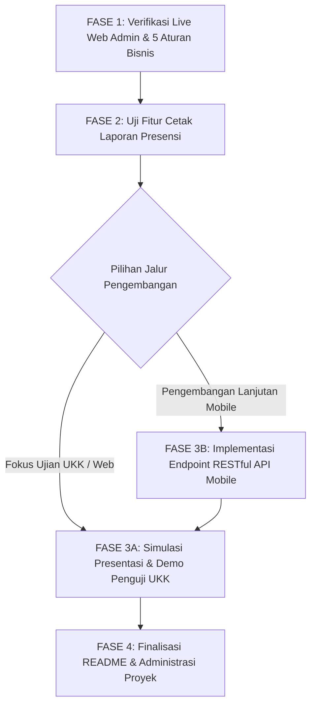

# 🚀 PANDUAN LANGKAH SELANJUTNYA & MASTER ROADMAP
## Sistem School Class Progress (SCP) — UKK 2026 Paket 3 RPL

> **Status Proyek:** Backend Core, Database Schema, Filament Resources v3, 5 Logika Bisnis Utama, Dashboard Widgets, & Automated Testing telah **SELESAI & 100% PASSED**.  
> **Tujuan Dokumen:** Memberikan panduan terstruktur langkah demi langkah (*actionable steps*) untuk melanjutkan pengujian web admin, penyempurnaan laporan, pengembangan RESTful API Mobile, hingga persiapan demonstrasi di hadapan Penguji UKK.

---

## 📊 1. REKAP STATUS PROYEK SAAT INI

| Komponen / Fitur | Status | Keterangan |
| :--- | :---: | :--- |
| **Database Schema & Migrations** | ✅ Selesai | 16 file migrasi terstruktur rapi (termasuk `academic_years`, `subjects`, `user_class`, `personal_access_tokens`). |
| **Model & Eloquent Relationships** | ✅ Selesai | Relasi antar model terhubung lengkap dengan strict type casting PHP 8.3+. |
| **5 Logika Bisnis Utama UKK** | ✅ Selesai | 1. Anti-Bentrok Jadwal (`NoScheduleConflict`)<br>2. Toggle Putaran Blok (Siklus 1/2)<br>3. Lock Schedule (Kunci Jadwal Waka)<br>4. Sinkronisasi Izin Otomatis (`JournalObserver`)<br>5. Dashboard Alert Reminder (>30 mnt tanpa cron). |
| **Filament Admin Resources v3** | ✅ Selesai | CRUD lengkap: Users, Classrooms, Rooms, Subjects, AcademicYears, Schedules, Journals, LeaveRequests, SystemConfigurations. |
| **Dashboard Widgets & Custom Pages** | ✅ Selesai | StatsOverview, UnfilledJournalAlert, StudentAttendanceWidget, SystemConfigWidget, AttendanceReport Custom Page. |
| **Laporan & Cetak PDF** | ✅ Selesai | Fitur filter kelas, tanggal, dan controller cetak kop surat (`attendance-report.print`). |
| **Automated Testing (PHPUnit)** | ✅ 100% Passed | Seluruh pengujian fitur (`ScheduleConflictTest`, `JournalAttendanceSyncTest`, `ScheduleResourceTest`) lulus uji. |
| **RESTful API Mobile (Sanctum)** | ⏳ Siap Dibuat | Panduan arsitektur telah disiapkan di `LANGKAH_STEP_12_REST_API_MOBILE.md`. |

---

## 🗺️ 2. ROADMAP & URUTAN LANGKAH SELANJUTNYA

Berikut urutan tahapan yang direkomendasikan untuk Anda kerjakan selanjutnya:



---

## 🛠️ 3. PANDUAN DETAIL SETIAP FASE

---

### 📍 FASE 1: VERIFIKASI LIVE WEB ADMIN & PENGUJIAN 5 ATURAN BISNIS

Tujuan fase ini adalah memastikan seluruh antarmuka Filament Admin berjalan mulus di browser dan 5 logika bisnis UKK bekerja sesuai ekspektasi.

#### Langkah 1.1: Menjalankan Server Lokal
Buka 2 tab terminal di VS Code / Terminal Anda:
```bash
# Terminal 1: Jalankan Web Server Laravel
php artisan serve

# Terminal 2: Jalankan Vite Asset Compiler (jika diperlukan)
npm run dev
```

#### Langkah 1.2: Login Menggunakan Kredensial Uji Coba
Buka browser di `http://127.0.0.1:8000/admin` dan uji login dengan akun berikut (Password default: `password`):

| Role | Username | Fungsi Utama yang Diuji |
| :--- | :--- | :--- |
| **Waka Kurikulum** | `waka_kurikulum` | Ganti Putaran (1 ke 2), Kunci/Buka Jadwal (Lock Schedule), Kelola Master Data. |
| **Guru Pengajar** | `guru_andi` / `guru_budi` | Input Jadwal (uji bentrok), Input Jurnal + Foto, Lihat Notifikasi Terlambat. |
| **Wali Kelas / BK** | `wali_rpl1` / `guru_bk` | Verifikasi/Approve surat perizinan siswa, Pantau absensi kelas binaan. |
| **Siswa / Orang Tua** | `siswa_budi` / `siswa_ani` | Pengajuan Surat Izin + Upload berkas, Lihat persentase kehadiran di dashboard. |

#### Langkah 1.3: Skenario Pengujian 5 Logika Bisnis Utama:
1. **Uji Anti-Bentrok Jadwal (Conflict Prevention):**
   - Login sebagai Guru -> Buat jadwal baru di Hari `Senin`, Ruang `Lab RPL 1`, Kelas `XII RPL 1`, Pukul `07:00 - 09:00`, `Putaran 1`.
   - Coba buat jadwal kedua dengan Guru berbeda di Hari yang sama, Jam yang sama (`08:00 - 10:00`), atau Ruang yang sama.
   - **Hasil Diharapkan:** Sistem memunculkan pesan validasi error dan menolak penyimpanan.
2. **Uji Lock Schedule:**
   - Login sebagai Waka Kurikulum -> Buka menu *Konfigurasi Sistem* -> Aktifkan *Kunci Jadwal*.
   - Login kembali sebagai Guru -> Masuk menu *Jadwal Mengajar*.
   - **Hasil Diharapkan:** Tombol `Buat Jadwal Baru`, `Edit`, dan `Hapus` disembunyikan/dilarang.
3. **Uji Sinkronisasi Izin Otomatis:**
   - Login sebagai Siswa -> Ajukan Izin tanggal hari ini -> Upload dokumen bukti.
   - Login sebagai Wali Kelas -> Approve perizinan tersebut.
   - Login sebagai Guru -> Buat Jurnal mengajar untuk kelas siswa tersebut pada tanggal hari ini.
   - **Hasil Diharapkan:** Saat jurnal tersimpan, status presensi siswa otomatis tercatat sebagai `Izin`/`Sakit`, sedangkan siswa lain otomatis `Hadir`.
4. **Uji Dashboard Alert Reminder:**
   - Pastikan ada jadwal guru yang jam selesainya sudah lewat lebih dari 30 menit dari jam sekarang dan belum diisi jurnalnya.
   - Buka Dashboard Guru.
   - **Hasil Diharapkan:** Muncul banner/card peringatan merah/kuning berisi daftar jadwal yang belum dibuatkan jurnal.

---

### 📍 FASE 2: UJI FITUR CETAK LAPORAN PRESENSI & JURNAL (STEP 10)

Tujuan fase ini adalah memastikan fitur pelaporan siap dicetak dalam format resmi (PDF / Printable).

#### Langkah 2.1: Uji Filter Halaman Laporan
1. Login sebagai **Waka Kurikulum** atau **Wali Kelas**.
2. Klik menu **Laporan & Rekap** -> **Laporan Presensi** (`/admin/attendance-report`).
3. Pilih salah satu **Kelas Target** (misal: `XII RPL 1`).
4. Tentukan **Rentang Tanggal** (misal: awal bulan s/d akhir bulan ini).
5. Periksa tabel preview: pastikan kolom Hadir, Sakit, Izin, Alpa, dan Persentase Kehadiran terhitung dengan akurat.

#### Langkah 2.2: Uji Cetak Laporan (Print / PDF)
1. Klik tombol hijau **Cetak Laporan (PDF / Print)** di pojok kanan atas filter.
2. Jendela browser print preview akan terbuka secara otomatis dengan kop surat resmi *School Class Progress*.
3. Periksa kerapian tampilan dan tanda tangan pengesahan (Waka Kurikulum & Wali Kelas).

---

### 📍 FASE 3: PILIHAN PENGEMBANGAN LANJUTAN

Pilihlah salah satu dari dua jalur berikut sesuai kebutuhan Anda:

#### 🅰️ JALUR A: PERSIAPAN DEMO & PENILAIAN UKK (Rekomendasi Utama)
Jika fokus Anda adalah mempersiapkan diri untuk ujian praktik UKK di hadapan asesor/penguji:
1. Buka file panduan: [`Instruction/LANGKAH_STEP_11_PENGUJIAN_FINAL_DEMO_DAN_PENILAIAN_UKK.md`](file:///d:/Project%20UKK/Paket%203%20SCP/SCP_SMK/Instruction/LANGKAH_STEP_11_PENGUJIAN_FINAL_DEMO_DAN_PENILAIAN_UKK.md).
2. Lakukan sterilisasi data pengujian (*Clean Database*):
   ```bash
   php artisan migrate:fresh --seed
   php artisan storage:link
   php artisan optimize:clear
   php artisan test
   ```
3. Latih skenario presentasi 15 menit menggunakan script demo yang ada di dokumen Step 11.
4. Cocokkan hasil aplikasi dengan **Rubrik Penilaian UKK (Skor Maksimal 100)**.

---

#### 🅱️ JALUR B: PENGEMBANGAN RESTful API MOBILE (STEP 12)
Jika Anda ingin melengkapi endpoint REST API untuk dihubungkan ke aplikasi Mobile (Flutter / React Native / Postman):
1. Buka file panduan: [`Instruction/LANGKAH_STEP_12_REST_API_MOBILE.md`](file:///d:/Project%20UKK/Paket%203%20SCP/SCP_SMK/Instruction/LANGKAH_STEP_12_REST_API_MOBILE.md).
2. Buat Form Request Classes untuk validasi API:
   ```bash
   php artisan make:request Api/Auth/LoginRequest
   php artisan make:request Api/Journal/StoreJournalRequest
   php artisan make:request Api/LeaveRequest/StoreLeaveRequest
   ```
3. Buat API Resources untuk transformasi response JSON:
   ```bash
   php artisan make:resource UserResource
   php artisan make:resource ScheduleResource
   php artisan make:resource JournalResource
   php artisan make:resource LeaveRequestResource
   ```
4. Buat API Controllers:
   ```bash
   php artisan make:controller Api/AuthController
   php artisan make:controller Api/ScheduleController
   php artisan make:controller Api/JournalController
   php artisan make:controller Api/LeaveRequestController
   php artisan make:controller Api/AttendanceReportController
   ```
5. Daftarkan endpoint di `routes/api.php` dan uji menggunakan Postman atau curl.

---

### 📍 FASE 4: FINALISASI DOKUMENTASI & PEMBERSIHAN KODE

1. **Perbarui `README.md`:**
   - Tambahkan instruksi instalasi proyek (Clone, `.env`, Migrate Seed, Serve).
   - Cantumkan tabel kredensial akun login setiap role.
   - Cantumkan daftar fitur utama dan 5 logika bisnis UKK.
2. **Git Commit & Push Terakhir:**
   ```bash
   git add .
   git commit -m "feat: complete UKK Paket 3 SCP implementation with all 5 core business rules, reporting, and full testing pass"
   ```

---

## 📋 4. CHECKLIST KESIAPAN AKHIR (READY TO DEMO)

Centang item berikut sebelum melakukan presentasi / pengumpulan proyek:

- [ ] Seluruh migrasi database berjalan sukses (`php artisan migrate:status`)
- [ ] Database seeder terisi lengkap dengan akun setiap role (`php artisan db:seed`)
- [ ] Storage symlink aktif untuk upload foto bukti (`php artisan storage:link`)
- [ ] Automated Testing 100% PASSED tanpa error (`php artisan test`)
- [ ] 5 Logika Bisnis Utama teruji dan berfungsi normal di browser
- [ ] Fitur Cetak Laporan Presensi menampilkan data dan kop surat dengan benar
- [ ] Dokumen README dan instruksi proyek lengkap

---

## 💡 PERINTAH CEPAT (CHEATSHEET TERMINAL)

```bash
# Menjalankan Pengujian Otomatis
php artisan test

# Membersihkan Seluruh Cache Aplikasi
php artisan optimize:clear

# Reset Database & Isi Data Sampel Resmi
php artisan migrate:fresh --seed

# Menjalankan Server Backend
php artisan serve
```
