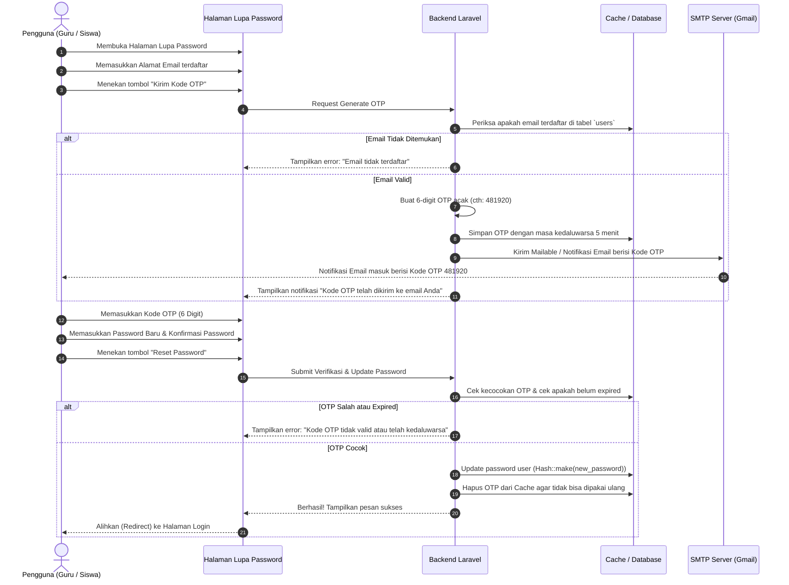

# 📧 PANDUAN LENGKAP: RESET PASSWORD VIA EMAIL ASLI & KODE OTP
## Project: School Class Progress (SCP) — SMK / UKK RPL 2026

Dokumen ini menjelaskan secara menyeluruh tentang:
1. **Cara beralih dari Mailtrap (sandbox) ke Email Asli (Gmail SMTP / Brevo)** agar email benar-benar masuk ke inbox pengguna.
2. **Arsitektur dan Alur Reset Password berbasis Kode OTP (One-Time Password)** pada sistem Laravel & Filament Admin Panel.
3. **Panduan Implementasi Kode (Backend, Filament Auth Page, dan REST API Mobile)**.
4. **Langkah Pengujian dan Penyelesaian Masalah (Troubleshooting)**.

---

## 📑 DAFTAR ISI

1. [Perbedaan Mailtrap vs Email Asli](#1-perbedaan-mailtrap-vs-email-asli)
2. [Konfigurasi SMTP Email Asli (Gmail & Brevo)](#2-konfigurasi-smtp-email-asli-gmail--brevo)
3. [Pengaturan File `.env` & Verifikasi Koneksi](#3-pengaturan-file-env--verifikasi-koneksi)
4. [Arsitektur & Alur Kerja Reset Password Berbasis OTP](#4-arsitektur--alur-kerja-reset-password-berbasis-otp)
5. [Implementasi Teknis di Backend Laravel](#5-implementasi-teknis-di-backend-laravel)
6. [Implementasi pada Filament Admin Panel](#6-implementasi-pada-filament-admin-panel)
7. [Implementasi pada REST API Mobile (Flutter / Android)](#7-implementasi-pada-rest-api-mobile-flutter--android)
8. [Panduan Pengujian (Testing) & Troubleshooting](#8-panduan-pengujian-testing--troubleshooting)

---

## 1. Perbedaan Mailtrap vs Email Asli

### Mengapa saat ini email masuk ke Mailtrap?
Di file konfigurasi `.env`, saat ini sistem menggunakan:
```env
MAIL_HOST=sandbox.smtp.mailtrap.io
MAIL_PORT=2525
```
**Mailtrap Sandbox** adalah layanan server email palsu (*fake SMTP server*) yang dirancang khusus untuk tahap pengembangan (*development*). Fungsinya adalah **menjebak (trap)** semua email keluar agar pengembang bisa melihat tampilan email tanpa khawatir email tersebut terkirim ke alamat email nyata atau dianggap spam.

### Mengapa beralih ke Email Asli?
Untuk kebutuhan demonstrasi di hadapan penguji UKK atau pemakaian nyata di sekolah:
- Guru dan siswa harus menerima kode verifikasi/OTP langsung di aplikasi email pada smartphone atau browser mereka (Gmail, Yahoo, Outlook).
- Membuktikan integrasi sistem backend dengan protokol SMTP internet yang sesungguhnya.

---

## 2. Konfigurasi SMTP Email Asli (Gmail & Brevo)

Terdapat dua opsi penyedia SMTP gratis yang paling umum dan mudah digunakan:

### Opsi A: Menggunakan Akun Google (Gmail SMTP) — *Paling Populer*

> [!IMPORTANT]
> Google **TIDAK MENGIZINKAN** login SMTP menggunakan password email biasa. Anda **WAJIB** membuat **Sandi Aplikasi (App Password)** 16 digit setelah mengaktifkan Verifikasi 2 Langkah.

#### Langkah Pembuatan Sandi Aplikasi Gmail:
1. Buka browser dan login ke akun Google Anda di [myaccount.google.com](https://myaccount.google.com/).
2. Masuk ke menu **Keamanan (Security)** di bilah sisi kiri.
3. Pada bagian *Cara Anda login ke Google*, pastikan **Verifikasi 2 Langkah (2-Step Verification)** dalam status **Aktif**.
4. Di bilah pencarian bagian atas akun Google, ketik kata kunci: `Sandi Aplikasi` atau `App Passwords`.
5. Klik menu **Sandi Aplikasi**.
6. Masukkan nama aplikasi, contoh: `SCP SMK App`, lalu klik **Buat (Create)**.
7. Google akan menampilkan popup berisi **16 karakter sandi acak** (contoh: `abcd efgh ijkl mnop`).
8. Salin 16 karakter tersebut (tanpa spasi) untuk dimasukkan ke variabel `MAIL_PASSWORD` di file `.env`.

---

### Opsi B: Menggunakan Brevo (Dahulu Sendinblue) — *Paling Stabil untuk Demo UKK*

Jika Anda tidak ingin menggunakan akun Gmail pribadi, **Brevo** menyediakan layanan SMTP gratis hingga 300 email/hari tanpa batasan keamanan perangkat Google.

#### Langkah Setup Brevo:
1. Daftar akun gratis di [brevo.com](https://www.brevo.com/).
2. Masuk ke menu **Transactional** -> **Settings** -> **Configuration**.
3. Di sana akan tersedia parameter SMTP resmi:
   - **SMTP Server:** `smtp-relay.brevo.com`
   - **Port:** `587`
   - **Login / Username:** email akun Brevo Anda
   - **SMTP Key / Password:** API Key Master yang digenerate

---

## 3. Pengaturan File `.env` & Verifikasi Koneksi

### A. Konfigurasi `.env` untuk Gmail SMTP

Buka file `.env` di root project, cari bagian `MAIL_...` dan sesuaikan nilainya:

```env
MAIL_MAILER=smtp
MAIL_SCHEME=null
MAIL_HOST=smtp.gmail.com
MAIL_PORT=587
MAIL_USERNAME=sekolah.scp.smk@gmail.com
MAIL_PASSWORD=abcdefghijklmnop
MAIL_ENCRYPTION=tls
MAIL_FROM_ADDRESS="sekolah.scp.smk@gmail.com"
MAIL_FROM_NAME="School Class Progress"
```

> [!NOTE]
> - Ganti `sekolah.scp.smk@gmail.com` dengan alamat email Gmail Anda.
> - Ganti `abcdefghijklmnop` dengan 16 karakter Sandi Aplikasi dari Google.
> - Pastikan `MAIL_ENCRYPTION=tls` dan `MAIL_PORT=587`.

### B. Bersihkan Cache Konfigurasi Laravel
Setiap kali mengubah isi file `.env`, jalankan perintah berikut di terminal:
```bash
php artisan config:clear
php artisan cache:clear
```

### C. Uji Coba Pengiriman Email via Artisan Tinker
Untuk memastikan server bisa mengirim email ke inbox asli tanpa membuka web terlebih dahulu:
```bash
php artisan tinker
```
Lalu ketikkan perintah berikut di dalam konsol Tinker:
```php
Mail::raw('Halo! Ini adalah uji coba pengiriman email dari aplikasi SCP SMK.', function ($message) {
    $message->to('email_tujuan_anda@gmail.com')
            ->subject('Uji Coba SMTP Email Asli');
});
```
Jika berhasil, konsol Tinker akan selesai tanpa error, dan email akan langsung masuk ke inbox email tujuan Anda dalam beberapa detik.

---

## 4. Arsitektur & Alur Kerja Reset Password Berbasis OTP

Fitur standar Laravel & Filament menggunakan tautan (*reset link* dengan query string `?token=...`). Namun untuk pengalaman pengguna yang lebih cepat dan ramah mobile, kita menggunakan sistem **Kode OTP 6 Digit**.

### Diagram Alur (Workflow):



### Prinsip Keamanan OTP:
1. **Digit Acak**: Menggunakan fungsi kriptografi aman `random_int(100000, 999999)`.
2. **Expiration Time**: OTP hanya berlaku selama **5 menit**.
3. **Single Use**: Begitu password berhasil diubah, OTP langsung dihapus dari memory/database.
4. **Rate Limiting**: Batasi permintaan kirim ulang OTP maksimal 1 kali per menit untuk mencegah spam email.

---

## 5. Implementasi Teknis di Backend Laravel

### Langkah 5.1: Buat Notification untuk Email OTP

Jalankan perintah pembuatan Notification:
```bash
php artisan make:notification ResetPasswordOtpNotification
```

Buka file `app/Notifications/ResetPasswordOtpNotification.php` dan isi dengan kode berikut:

```php
<?php

namespace App\Notifications;

use Illuminate\Bus\Queueable;
use Illuminate\Notifications\Messages\MailMessage;
use Illuminate\Notifications\Notification;

class ResetPasswordOtpNotification extends Notification
{
    use Queueable;

    public function __construct(
        public string $otp,
        public int $validityMinutes = 5
    ) {}

    public function via(object $notifiable): array
    {
        return ['mail'];
    }

    public function toMail(object $notifiable): MailMessage
    {
        return (new MailMessage)
            ->subject('Kode OTP Reset Password - School Class Progress')
            ->greeting('Halo, ' . $notifiable->full_name . '!')
            ->line('Kami menerima permintaan untuk mereset kata sandi akun Anda di sistem School Class Progress.')
            ->line('Gunakan kode OTP berikut untuk melanjutkan proses reset password:')
            ->line('# ' . $this->otp)
            ->line('Kode ini hanya berlaku selama ' . $this->validityMinutes . ' menit.')
            ->line('Jika Anda tidak merasa melakukan permintaan ini, abaikan email ini. Kata sandi Anda tetap aman.')
            ->salutation('Salam hormat, Tim Pengembang SCP SMK');
    }
}
```

---

### Langkah 5.2: Buat Service Logika OTP (`PasswordResetOtpService.php`)

Buat file baru di `app/Services/PasswordResetOtpService.php`:

```php
<?php

namespace App\Services;

use App\Models\User;
use App\Notifications\ResetPasswordOtpNotification;
use Illuminate\Support\Facades\Cache;
use Illuminate\Support\Facades\Hash;
use Illuminate\Validation\ValidationException;

class PasswordResetOtpService
{
    protected const OTP_EXPIRY_MINUTES = 5;

    /**
     * Generate dan kirim OTP ke email user.
     */
    public function sendOtp(string $email): void
    {
        $user = User::where('email', $email)->first();

        if (! $user) {
            throw ValidationException::withMessages([
                'email' => 'Alamat email tidak terdaftar dalam sistem.',
            ]);
        }

        // Cek rate limiting (jangan spam kirim OTP berturut-turut)
        $rateLimitKey = 'otp_rate_limit_' . md5($email);
        if (Cache::has($rateLimitKey)) {
            $secondsRemaining = Cache::get($rateLimitKey) - time();
            if ($secondsRemaining > 0) {
                throw ValidationException::withMessages([
                    'email' => "Harap tunggu {$secondsRemaining} detik sebelum meminta kode OTP baru.",
                ]);
            }
        }

        // Generate 6 digit angka
        $otp = (string) random_int(100000, 999999);

        // Simpan OTP di Cache selama 5 menit
        $cacheKey = 'password_reset_otp_' . md5($email);
        Cache::put($cacheKey, [
            'otp' => $otp,
            'user_id' => $user->id,
        ], now()->addMinutes(self::OTP_EXPIRY_MINUTES));

        // Set cooldown resend 60 detik
        Cache::put($rateLimitKey, time() + 60, now()->addSeconds(60));

        // Kirim email
        $user->notify(new ResetPasswordOtpNotification($otp, self::OTP_EXPIRY_MINUTES));
    }

    /**
     * Verifikasi OTP dan perbarui password user.
     */
    public function resetPassword(string $email, string $otp, string $newPassword): void
    {
        $cacheKey = 'password_reset_otp_' . md5($email);
        $cachedData = Cache::get($cacheKey);

        if (! $cachedData) {
            throw ValidationException::withMessages([
                'otp' => 'Kode OTP telah kedaluwarsa atau belum pernah diminta.',
            ]);
        }

        if ($cachedData['otp'] !== trim($otp)) {
            throw ValidationException::withMessages([
                'otp' => 'Kode OTP yang Anda masukkan salah.',
            ]);
        }

        $user = User::find($cachedData['user_id']);
        if (! $user) {
            throw ValidationException::withMessages([
                'email' => 'Pengguna tidak ditemukan.',
            ]);
        }

        // Update password baru
        $user->update([
            'password' => Hash::make($newPassword),
        ]);

        // Hapus OTP dari cache agar tidak bisa digunakan lagi
        Cache::forget($cacheKey);
        Cache::forget('otp_rate_limit_' . md5($email));
    }
}
```

---

## 6. Implementasi pada Filament Admin Panel

### Langkah 6.1: Buat Halaman Custom Reset Password Filament

Buat file baru di `app/Filament/Pages/Auth/ResetPasswordOtp.php`:

```php
<?php

namespace App\Filament\Pages\Auth;

use App\Services\PasswordResetOtpService;
use Filament\Actions\Action;
use Filament\Forms\Components\TextInput;
use Filament\Notifications\Notification;
use Filament\Pages\SimplePage;
use Filament\Schemas\Components\Component;
use Filament\Schemas\Schema;
use Illuminate\Contracts\Support\Htmlable;
use Illuminate\Validation\ValidationException;

class ResetPasswordOtp extends SimplePage
{
    protected string $view = 'filament.pages.auth.reset-password-otp';

    public ?string $email = '';
    public ?string $otp = '';
    public ?string $password = '';
    public ?string $password_confirmation = '';
    public bool $isOtpSent = false;

    public function getTitle(): string|Htmlable
    {
        return 'Reset Password dengan OTP';
    }

    public function getHeading(): string|Htmlable
    {
        return 'Lupa Kata Sandi';
    }

    public function getSubheading(): string|Htmlable|null
    {
        return 'Masukkan email Anda untuk menerima kode OTP 6-digit.';
    }

    public function sendOtpAction(): void
    {
        $this->validate([
            'email' => ['required', 'email'],
        ], [
            'email.required' => 'Email wajib diisi.',
            'email.email' => 'Format email tidak valid.',
        ]);

        try {
            app(PasswordResetOtpService::class)->sendOtp($this->email);

            $this->isOtpSent = true;

            Notification::make()
                ->title('Kode OTP Terkirim')
                ->body('Silakan periksa kotak masuk (inbox) atau spam di email Anda.')
                ->success()
                ->send();
        } catch (ValidationException $e) {
            Notification::make()
                ->title('Gagal Mengirim OTP')
                ->body($e->getMessage())
                ->danger()
                ->send();
            throw $e;
        } catch (\Throwable $e) {
            Notification::make()
                ->title('Gagal Menghubungi Server Email')
                ->body('Terjadi kesalahan koneksi SMTP. Silakan periksa pengaturan email.')
                ->danger()
                ->send();
        }
    }

    public function resetPasswordAction(): void
    {
        $this->validate([
            'email' => ['required', 'email'],
            'otp' => ['required', 'numeric', 'digits:6'],
            'password' => ['required', 'min:8', 'confirmed'],
        ], [
            'otp.required' => 'Kode OTP wajib diisi.',
            'otp.digits' => 'Kode OTP harus berupa 6 digit angka.',
            'password.required' => 'Password baru wajib diisi.',
            'password.min' => 'Password minimal 8 karakter.',
            'password.confirmed' => 'Konfirmasi password tidak cocok.',
        ]);

        try {
            app(PasswordResetOtpService::class)->resetPassword(
                $this->email,
                $this->otp,
                $this->password
            );

            Notification::make()
                ->title('Password Berhasil Diubah')
                ->body('Silakan masuk kembali dengan password baru Anda.')
                ->success()
                ->send();

            $this->redirect(filament()->getLoginUrl());
        } catch (ValidationException $e) {
            Notification::make()
                ->title('Validasi Gagal')
                ->body($e->getMessage())
                ->danger()
                ->send();
            throw $e;
        }
    }
}
```

---

### Langkah 6.2: Buat View Blade Halaman OTP

Buat file view di `resources/views/filament/pages/auth/reset-password-otp.blade.php`:

```blade
<x-filament-panels::page.simple>
    <div class="space-y-6">
        {{-- Form Step 1: Input Email & Kirim OTP --}}
        <div>
            <label class="block text-sm font-medium text-gray-700 dark:text-gray-200">Alamat Email Terdaftar</label>
            <div class="mt-1 flex gap-2">
                <input 
                    type="email" 
                    wire:model="email" 
                    placeholder="nama@smk.sch.id"
                    class="block w-full rounded-lg border-gray-300 shadow-sm focus:border-primary-500 focus:ring-primary-500 dark:bg-gray-800 dark:border-gray-700 dark:text-white sm:text-sm"
                    @if($isOtpSent) readonly @endif
                />
                <button 
                    type="button" 
                    wire:click="sendOtpAction"
                    wire:loading.attr="disabled"
                    class="inline-flex items-center px-4 py-2 border border-transparent text-sm font-medium rounded-lg text-white bg-primary-600 hover:bg-primary-700 focus:outline-none focus:ring-2 focus:ring-offset-2 focus:ring-primary-500 disabled:opacity-50"
                >
                    <span wire:loading.remove wire:target="sendOtpAction">
                        {{ $isOtpSent ? 'Kirim Ulang' : 'Kirim OTP' }}
                    </span>
                    <span wire:loading wire:target="sendOtpAction">Mengirim...</span>
                </button>
            </div>
            @error('email') <span class="text-xs text-red-500 mt-1 block">{{ $message }}</span> @enderror
        </div>

        @if($isOtpSent)
        {{-- Form Step 2: Input OTP & Password Baru (Muncul setelah OTP dikirim) --}}
        <form wire:submit="resetPasswordAction" class="space-y-4 pt-4 border-t border-gray-200 dark:border-gray-700">
            <div>
                <label class="block text-sm font-medium text-gray-700 dark:text-gray-200">Kode OTP (6 Digit)</label>
                <input 
                    type="text" 
                    wire:model="otp" 
                    maxlength="6"
                    placeholder="Contoh: 123456" 
                    class="mt-1 block w-full text-center tracking-widest text-lg font-bold rounded-lg border-gray-300 shadow-sm focus:border-primary-500 focus:ring-primary-500 dark:bg-gray-800 dark:border-gray-700 dark:text-white"
                />
                @error('otp') <span class="text-xs text-red-500 mt-1 block">{{ $message }}</span> @enderror
            </div>

            <div>
                <label class="block text-sm font-medium text-gray-700 dark:text-gray-200">Kata Sandi Baru</label>
                <input 
                    type="password" 
                    wire:model="password" 
                    placeholder="Minimal 8 karakter"
                    class="mt-1 block w-full rounded-lg border-gray-300 shadow-sm focus:border-primary-500 focus:ring-primary-500 dark:bg-gray-800 dark:border-gray-700 dark:text-white sm:text-sm"
                />
                @error('password') <span class="text-xs text-red-500 mt-1 block">{{ $message }}</span> @enderror
            </div>

            <div>
                <label class="block text-sm font-medium text-gray-700 dark:text-gray-200">Konfirmasi Kata Sandi Baru</label>
                <input 
                    type="password" 
                    wire:model="password_confirmation" 
                    placeholder="Ulangi kata sandi baru"
                    class="mt-1 block w-full rounded-lg border-gray-300 shadow-sm focus:border-primary-500 focus:ring-primary-500 dark:bg-gray-800 dark:border-gray-700 dark:text-white sm:text-sm"
                />
            </div>

            <button 
                type="submit" 
                wire:loading.attr="disabled"
                class="w-full mt-4 flex justify-center py-2.5 px-4 border border-transparent rounded-lg shadow-sm text-sm font-semibold text-white bg-primary-600 hover:bg-primary-700 focus:outline-none focus:ring-2 focus:ring-offset-2 focus:ring-primary-500"
            >
                <span wire:loading.remove wire:target="resetPasswordAction">Simpan Kata Sandi Baru</span>
                <span wire:loading wire:target="resetPasswordAction">Memproses...</span>
            </button>
        </form>
        @endif

        <div class="text-center mt-4">
            <a href="{{ filament()->getLoginUrl() }}" class="text-sm font-medium text-primary-600 hover:text-primary-500 dark:text-primary-400">
                &larr; Kembali ke Halaman Masuk
            </a>
        </div>
    </div>
</x-filament-panels::page.simple>
```

---

### Langkah 6.3: Daftarkan Halaman di `AdminPanelProvider.php`

Buka file `app/Providers/Filament/AdminPanelProvider.php`, sesuaikan baris `passwordReset()`:

```php
use App\Filament\Pages\Auth\ResetPasswordOtp;

// Pada method panel(Panel $panel):
return $panel
    // ...
    ->login(Login::class)
    ->passwordReset(ResetPasswordOtp::class) // Menggunakan custom page OTP
    // ...
```

---

## 7. Implementasi pada REST API Mobile (Flutter / Android)

Untuk aplikasi mobile siswa atau guru yang terhubung lewat REST API, sediakan 2 endpoint di `routes/api.php`:

### A. Tambahkan Route di `routes/api.php`
```php
use App\Http\Controllers\Api\ForgotPasswordOtpController;

// Public Routes (Lupa Password API)
Route::post('/forgot-password/send-otp', [ForgotPasswordOtpController::class, 'sendOtp']);
Route::post('/forgot-password/reset', [ForgotPasswordOtpController::class, 'resetPassword']);
```

### B. Controller API (`ForgotPasswordOtpController.php`)
```php
<?php

namespace App\Http\Controllers\Api;

use App\Http\Controllers\Controller;
use App\Services\PasswordResetOtpService;
use Illuminate\Http\JsonResponse;
use Illuminate\Http\Request;
use Illuminate\Validation\ValidationException;

class ForgotPasswordOtpController extends Controller
{
    public function __construct(
        protected PasswordResetOtpService $otpService
    ) {}

    public function sendOtp(Request $request): JsonResponse
    {
        $request->validate([
            'email' => 'required|email',
        ]);

        try {
            $this->otpService->sendOtp($request->email);

            return response()->json([
                'status' => 'success',
                'message' => 'Kode OTP telah dikirimkan ke email Anda.',
            ], 200);
        } catch (ValidationException $e) {
            return response()->json([
                'status' => 'error',
                'message' => $e->validator->errors()->first(),
            ], 422);
        } catch (\Throwable $e) {
            return response()->json([
                'status' => 'error',
                'message' => 'Gagal mengirim email OTP. Silakan periksa koneksi internet atau hubungi admin.',
            ], 500);
        }
    }

    public function resetPassword(Request $request): JsonResponse
    {
        $request->validate([
            'email' => 'required|email',
            'otp' => 'required|numeric|digits:6',
            'password' => 'required|min:8|confirmed',
        ]);

        try {
            $this->otpService->resetPassword(
                $request->email,
                $request->otp,
                $request->password
            );

            return response()->json([
                'status' => 'success',
                'message' => 'Kata sandi berhasil direset. Silakan login kembali.',
            ], 200);
        } catch (ValidationException $e) {
            return response()->json([
                'status' => 'error',
                'message' => $e->validator->errors()->first(),
            ], 422);
        }
    }
}
```

---

## 8. Panduan Pengujian (Testing) & Troubleshooting

### Checklist Uji Kompetensi (UKK Scenario):

| No | Skenario Pengujian | Aksi | Hasil yang Diharapkan | Status |
|:--:|:-------------------|:-----|:----------------------|:------:|
| 1 | Kirim ke Email Tidak Terdaftar | Input `acak@gmail.com` | Muncul notifikasi "Alamat email tidak terdaftar" | [ ] |
| 2 | Kirim ke Email Asli | Input email yang ada di tabel `users` | Notifikasi "Kode OTP Terkirim", email masuk ke inbox | [ ] |
| 3 | Input OTP Salah | Masukkan kode `000000` | Error "Kode OTP yang Anda masukkan salah" | [ ] |
| 4 | Input OTP Valid & Password Baru | Masukkan 6 digit yang diterima + password baru | Notifikasi berhasil, redirect ke Login | [ ] |
| 5 | Login dengan Password Baru | Masukkan NISN/NIP + Password baru | Berhasil login ke Dashboard | [ ] |
| 6 | Pakai Ulang OTP Lama | Coba submit kembali dengan OTP yang sama | Ditolak karena OTP sudah hangus (*single-use*) | [ ] |

---

### Solusi Masalah Umum (Troubleshooting):

#### 1. Error: `535-5.7.8 Username and Password not accepted`
- **Penyebab:** Anda menggunakan password login akun Gmail biasa, bukan Sandi Aplikasi (*App Password*), atau ada spasi di sandi aplikasi.
- **Solusi:** Buat Sandi Aplikasi baru di Google Account (16 karakter), hilangkan spasi, dan tempelkan ke `MAIL_PASSWORD` di `.env`.

#### 2. Error: `Connection could not be established with host smtp.gmail.com: Connection timed out`
- **Penyebab:** Port `587` atau `465` diblokir oleh firewall internet lokal / ISP / Wi-Fi sekolah.
- **Solusi:**
  - Coba ganti `MAIL_PORT=465` dan `MAIL_ENCRYPTION=ssl`.
  - Atau gunakan hotspot ponsel seluler untuk menguji coba koneksi.

#### 3. Email tidak masuk ke Inbox utama
- **Penyebab:** Penyedia email memasukkan pesan ke folder filter promosi atau spam karena reputasi domain baru.
- **Solusi:** Periksa folder **Spam** atau **Junk** pada akun Gmail tujuan. Klik *Laporkan Bukan Spam* agar selanjutnya masuk ke inbox utama.

#### 4. Kode OTP langsung kedaluwarsa padahal baru dikirim
- **Penyebab:** Perbedaan zona waktu (*time drift*) antara server lokal dan jam komputer.
- **Solusi:** Pastikan `APP_TIMEZONE=Asia/Jakarta` diatur pada file `config/app.php` dan jam sistem komputer Anda sudah tersinkronisasi otomatis (*Sync Now* di Windows Date & Time).

---

> 💡 **Dokumen ini dibuat untuk standarisasi penilaian UKK RPL Paket 3.** Simpan file ini sebagai rujukan implementasi dan presentasi sistem.
