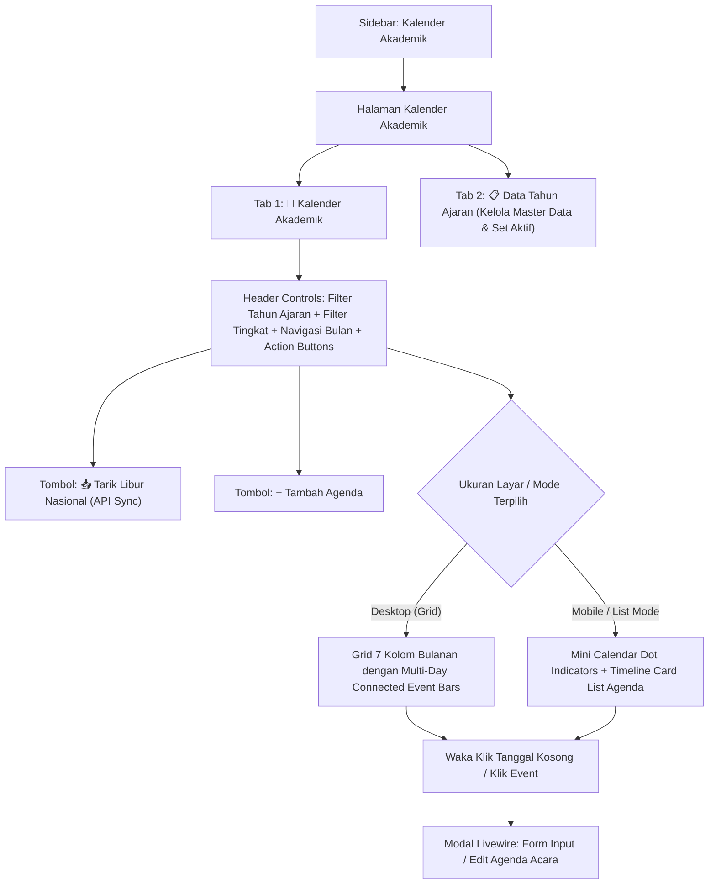

# 📅 Rencana Kerja & Solusi Arsitektur: Transformasi Halaman Tahun Ajaran Menjadi Kalender Akademik Interaktif

Dokumen ini berisi rancangan komprehensif untuk mentransformasikan halaman **Tahun Ajaran** menjadi **Kalender Akademik** interaktif di SCP SMK, yang telah disempurnakan untuk mengatasi seluruh kendala teknis, performa database (bebas N+1), kebutuhan spesifik SMK (PKL & UKK), agenda Upacara dengan kewajiban presensi (`requires_attendance`), filtrasi semester pada API Hari Libur Nasional, serta pendaftaran warna custom di Filament.

---

## 🛠️ 1. Solusi untuk Masalah Kritis & Kebutuhan SMK

| No | Kebutuhan / Kendala | Solusi Arsitektur yang Diterapkan |
| :---: | :--- | :--- |
| **1** | **Pemisahan Logika KBM vs Wajib Hadir / Presensi** (Contoh: Hari Kemerdekaan 17 Agustus libur KBM tapi siswa wajib hadir Upacara) | **Kolom `requires_attendance` & Kategori `UPACARA`:** Menambahkan kolom `requires_attendance` (boolean, default TRUE). Kategori `UPACARA` diset dengan preset: `is_holiday = true`, `disable_kbm = true` (jadwal mengajar di kelas ditiadakan), dan `requires_attendance = true` (siswa wajib absen gerbang atau mengajukan surat izin resmi). |
| **2** | **Koreksi Filter Semester saat Tarik API Libur Nasional** (API mengembalikan 1 tahun penuh, tapi Tahun Ajaran terbagi per semester) | **Validasi Rentang Semester pada Looping API:** Saat tombol API Sync dijalankan, sistem hanya menyimpan hari libur yang tanggalnya berada di antara `start_date` dan `end_date` dari Tahun Ajaran (Semester) yang sedang dipilih. Khusus Hari Kemerdekaan 17 Agustus, sistem otomatis menyetel `requires_attendance = true`. |
| **3** | **Pendaftaran Warna Custom (`teal` & `rose`) di Panel Filament** | **Registrasi Warna di `AdminPanelProvider`:** Filament v5 secara bawaan hanya memiliki 6 warna semantik. Agar badge PKL (`teal`) dan UKK (`rose`) tidak berubah menjadi abu-abu, warna `Color::Teal` dan `Color::Rose` didaftarkan secara eksplisit di provider panel admin. |
| **4** | **Kategori Khusus SMK (PKL & UKK)** (Kegiatan industri & uji keahlian khusus kelas XI & XII) | **Case Khusus di PHP Enum:** Menambahkan `PKL = 'pkl'` (Praktik Kerja Lapangan) dan `UKK = 'ukk'` (Uji Kompetensi Keahlian). Keduanya secara default mengatur `disable_kbm = true` dan `is_holiday = false` dengan target kelas otomatis (`XI/XII` untuk PKL, `XII` untuk UKK) sehingga KBM reguler kelas terkait ditiadakan tanpa mengganggu kelas lainnya. |
| **5** | **Cegah Masalah N+1 Query pada Rekap Presensi** (Menghindari ribuan query saat cetak rekap absensi) | **Eager Pre-fetching & In-Memory Lookup Table:** Penarikan seluruh agenda libur/kegiatan dalam 1 rentang periode rekap (1 bulan/semester) dilakukan **hanya dalam 1 query tunggal** di awal proses. Data di-flatten ke struktur array/map memori PHP dengan kompleksitas akses $O(1)$, menjamin proses rekap ratusan siswa berjalan sekejap (di bawah 100ms). |
| **6** | **Tombol Tarik Hari Libur Nasional (API Sync)** (Waka tidak perlu input manual tanggal merah tahunan) | **Integrasi API Publik Hari Libur:** Di bar atas kalender disematkan tombol aksi `📥 Tarik Libur Nasional (API Sync)` yang memanggil endpoint API Hari Libur Indonesia via `Http::get()`. Sistem melakukan `updateOrCreate` otomatis untuk seluruh tanggal merah tahun berjalan secara instan. |
| **7** | **Konflik Tahun Ajaran vs Navigasi Bulan** (Semester Ganjil Jul–Des, tapi user pilih Maret di kalender) | **Batas Tanggal Semester & Auto-Sync:** Menambahkan kolom `start_date` dan `end_date` pada tabel `academic_years` (contoh: 2026/2027 Ganjil = 2026-07-01 s/d 2026-12-31). Saat Tahun Ajaran dipilih, kalender otomatis menyesuaikan opsi bulan yang relevan, atau menampilkan *context banner* jika user sengaja menjelajah bulan di luar rentang semester aktif. |
| **8** | **Rendering Acara Multi-Hari (Multi-Day Bars)** (Acara rentang 1-2 minggu berantakan pada grid) | **Algoritma Week-Chunk Slotting & Connected Bars:** Menggunakan algoritma pembagian baris mingguan (*per-week slicing*). Setiap acara multi-hari dipecah per minggu kalender dengan *slot index* yang stabil: sudut kiri melengkung (`rounded-l`) di hari mulai, sudut kanan melengkung (`rounded-r`) di hari selesai, dan garis lurus menyambung di tengah. |
| **9** | **Eliminasi Redundansi Kategori & Warna** (Pemilihan warna manual berisiko inkonsisten) | **Single-Source of Truth via PHP Enum:** Menghapus input manual pemilihan warna. Warna, label, dan ikon sepenuhnya diatur oleh PHP Enum `AcademicEventCategory` (mengimplementasikan `HasLabel`, `HasColor`, `HasIcon`). Warna otomatis konsisten di seluruh aplikasi. |
| **10** | **Tampilan Mobile Tidak Ramah Pengguna** (Grid 7 kolom sangat sempit di layar HP) | **Desain Adaptif Hybrid (Dual-View):** <br>• **Desktop (`md:block`)**: Grid 7 kolom bulanan penuh dengan bar visual.<br>• **Mobile (`block md:hidden`)**: Kalender mini dengan titik warna (*colored dots*) + **Daftar Kartu Timeline Agenda** di bawahnya.<br>• Tombol toggle **[ 📅 Grid Kalender ]** dan **[ 📑 List Agenda ]** di semua perangkat. |
| **11** | **Fleksibilitas Database Tanpa Keterbatasan ENUM** | **Migrasi ke `VARCHAR(50)` terindeks:** Kolom `category` disimpan sebagai `VARCHAR(50)`. Penambahan kategori baru di kemudian hari cukup dilakukan di level PHP Enum tanpa perlu migrasi schema database (`ALTER TABLE`). |

---

## 🏗️ 2. Arsitektur Basis Data & Model (Database Schema)

### A. Perubahan Tabel `academic_years` (Menambahkan Batas Semester)
File migration baru: `add_dates_to_academic_years_table.php`
```sql
ALTER TABLE academic_years 
    ADD COLUMN start_date DATE NULL AFTER name,
    ADD COLUMN end_date DATE NULL AFTER start_date;
```

### B. Tabel Baru: `academic_events`
File migration: `create_academic_events_table.php`
```sql
CREATE TABLE academic_events (
    id BIGINT UNSIGNED AUTO_INCREMENT PRIMARY KEY,
    academic_year_id BIGINT UNSIGNED NULL,
    title VARCHAR(255) NOT NULL,
    category VARCHAR(50) NOT NULL DEFAULT 'kegiatan_siswa', -- VARCHAR(50) terindeks
    target_grades JSON NULL COMMENT '["X", "XI", "XII"] atau NULL jika seluruh sekolah',
    is_holiday BOOLEAN NOT NULL DEFAULT FALSE COMMENT 'Tanggal merah / libur resmi',
    disable_kbm BOOLEAN NOT NULL DEFAULT FALSE COMMENT 'KBM / jadwal guru ditiadakan untuk target_grades',
    requires_attendance BOOLEAN NOT NULL DEFAULT TRUE COMMENT 'Apakah siswa tetap wajib presensi (misal Upacara 17 Agustus)',
    start_date DATE NOT NULL,
    end_date DATE NOT NULL,
    is_all_day BOOLEAN NOT NULL DEFAULT TRUE,
    start_time TIME NULL,
    end_time TIME NULL,
    description TEXT NULL,
    created_by BIGINT UNSIGNED NULL,
    created_at TIMESTAMP NULL,
    updated_at TIMESTAMP NULL,
    INDEX idx_events_dates (start_date, end_date),
    INDEX idx_events_category (category),
    INDEX idx_events_holiday_kbm (is_holiday, disable_kbm, requires_attendance),
    FOREIGN KEY (academic_year_id) REFERENCES academic_years(id) ON DELETE CASCADE,
    FOREIGN KEY (created_by) REFERENCES users(id) ON DELETE SET NULL
);
```

### C. PHP Enum: `App\Enums\AcademicEventCategory`
Mengimplementasikan Filament Contracts untuk label, warna, ikon, dan default perilaku:
```php
namespace App\Enums;

use Filament\Support\Contracts\HasColor;
use Filament\Support\Contracts\HasIcon;
use Filament\Support\Contracts\HasLabel;

enum AcademicEventCategory: string implements HasLabel, HasColor, HasIcon
{
    case LIBUR_NASIONAL = 'libur_nasional';
    case LIBUR_SEKOLAH  = 'libur_sekolah';
    case UPACARA        = 'upacara';       // Upacara Bendera / Peringatan Hari Besar
    case UJIAN          = 'ujian';
    case PKL            = 'pkl';           // Praktik Kerja Lapangan (Khusus SMK)
    case UKK            = 'ukk';           // Uji Kompetensi Keahlian (Khusus SMK)
    case KEGIATAN_SISWA = 'kegiatan_siswa';
    case RAPAT          = 'rapat';
    case LAINNYA        = 'lainnya';

    public function getLabel(): string
    {
        return match ($this) {
            self::LIBUR_NASIONAL => 'Libur Nasional',
            self::LIBUR_SEKOLAH  => 'Libur Sekolah / Semester',
            self::UPACARA        => 'Upacara Bendera / Peringatan',
            self::UJIAN          => 'Ujian / Asesmen',
            self::PKL            => 'Praktik Kerja Lapangan (PKL)',
            self::UKK            => 'Uji Kompetensi Keahlian (UKK)',
            self::KEGIATAN_SISWA => 'Kegiatan Siswa / OSIS',
            self::RAPAT          => 'Rapat Guru / Dinas',
            self::LAINNYA        => 'Agenda Khusus Lainnya',
        };
    }

    public function getColor(): string|array
    {
        return match ($this) {
            self::LIBUR_NASIONAL => 'danger',   // Merah
            self::LIBUR_SEKOLAH  => 'warning',  // Kuning / Oranye
            self::UPACARA        => 'rose',     // Rose / Merah Bendera
            self::UJIAN          => 'info',     // Biru
            self::PKL            => 'teal',     // Cyan / Teal khas vokasi industri
            self::UKK            => 'rose',     // Rose / Merah bata khas uji kompetensi
            self::KEGIATAN_SISWA => 'success',  // Hijau
            self::RAPAT          => 'primary',  // Ungu / Brand
            self::LAINNYA        => 'gray',     // Abu-abu
        };
    }

    public function getIcon(): ?string
    {
        return match ($this) {
            self::LIBUR_NASIONAL => 'heroicon-o-flag',
            self::LIBUR_SEKOLAH  => 'heroicon-o-sun',
            self::UPACARA        => 'heroicon-o-megaphone',
            self::UJIAN          => 'heroicon-o-academic-cap',
            self::PKL            => 'heroicon-o-briefcase',
            self::UKK            => 'heroicon-o-wrench-screwdriver',
            self::KEGIATAN_SISWA => 'heroicon-o-sparkles',
            self::RAPAT          => 'heroicon-o-user-group',
            self::LAINNYA        => 'heroicon-o-calendar',
        };
    }

    // Default status libur resmi
    public function defaultIsHoliday(): bool
    {
        return in_array($this, [self::LIBUR_NASIONAL, self::LIBUR_SEKOLAH, self::UPACARA]);
    }

    // Default penonaktifan jadwal mengajar kelas
    public function defaultDisableKbm(): bool
    {
        return in_array($this, [
            self::LIBUR_NASIONAL, 
            self::LIBUR_SEKOLAH, 
            self::UPACARA, 
            self::UJIAN, 
            self::PKL, 
            self::UKK
        ]);
    }

    // Default kewajiban presensi / kehadiran siswa
    public function defaultRequiresAttendance(): bool
    {
        return match ($this) {
            self::LIBUR_NASIONAL, self::LIBUR_SEKOLAH => false, // Libur murni bebas absen
            self::UPACARA => true, // Upacara WAJIB hadir absen gerbang!
            default => true,
        };
    }

    // Rekomendasi otomatis target tingkat kelas saat Waka memilih kategori
    public function defaultTargetGrades(): ?array
    {
        return match ($this) {
            self::PKL => ['XII'],
            self::UKK => ['XII'],
            default   => null, // Berlaku seluruh sekolah
        };
    }
}
```

### D. Pendaftaran Warna Custom di `AdminPanelProvider.php`
Agar warna `'teal'` dan `'rose'` dikenali oleh Filament:
```php
use Filament\Support\Colors\Color;

public function panel(Panel $panel): Panel
{
    return $panel
        ->default()
        ->id('admin')
        ->path('admin')
        ->colors([
            'primary' => Color::Blue,
            'teal'    => Color::Teal,
            'rose'    => Color::Rose,
        ])
        // ...
}
```

### E. Model `App\Models\AcademicEvent`
- **Casts**:
  - `'category' => AcademicEventCategory::class`
  - `'target_grades' => 'array'`
  - `'is_holiday' => 'boolean'`
  - `'disable_kbm' => 'boolean'`
  - `'requires_attendance' => 'boolean'`
  - `'is_all_day' => 'boolean'`
  - `'start_date' => 'date'`
  - `'end_date' => 'date'`
- **Scopes & Helpers**:
  - `scopeForDateRange($query, $start, $end)`
  - `scopeActiveHolidayOrDisabledKbm($query, $start, $end)`
  - `appliesToGrade(?string $grade): bool`: Mengembalikan `true` jika `target_grades` bernilai `null` (berlaku seluruh sekolah) atau jika `$grade` ada di dalam array.

---

## 🎨 3. Rancangan Antarmuka UI/UX (Dual-View & Two-Tab Layout)



### A. Tab 1: Kalender Akademik (Tampilan Utama)
1. **Control Header Bar**:
   - **Filter Tahun Ajaran**: Dropdown tahun ajaran aktif/terpilih (tersinkronisasi dengan batas tanggal semester).
   - **Filter Target Tingkat (`target_grades`)**: Dropdown `[Semua Tingkat (Default), Kelas X, Kelas XI, Kelas XII]`.
   - **Month & Year Navigator**:
     - `[ ◀ ]` Bulan Lalu, `[ ▶ ]` Bulan Depan, Dropdown Bulan (Januari s/d Desember), dan Selector Tahun.
     - Tombol shortcut **"Hari Ini"**.
   - **Mode Tampilan (View Toggle)**:
     - Tombol switcher `[ 📅 Grid Kalender ]` & `[ 📑 List Agenda ]`.
   - **Tombol Aksi**:
     - `📥 Tarik Libur Nasional (API Sync)` *(Waka/Admin)*: Membuka modal aksi untuk menarik tanggal merah Indonesia via API publik khusus untuk rentang tanggal semester aktif secara otomatis.
     - `+ Tambah Agenda` *(Waka/Admin)*: Membuka modal input acara baru.

2. **Tampilan Desktop (Grid Bulanan 7 Kolom & Multi-Day Spanning Bar)**:
   - Kolom: Senin s/d Minggu.
   - **Algoritma Multi-Day Spanning**:
     - Acara multi-hari dipecah per baris mingguan dengan slotting stabil:
       - Hari awal: `rounded-l-md` (ikon & judul acara).
       - Hari di tengah baris: `rounded-none border-x-0` (bar warna menyambung).
       - Hari akhir: `rounded-r-md`.
   - Tag Tingkat: Jika agenda khusus tingkat tertentu, menampilkan badge kecil `[Kls XII]` atau `[Kls XI]` di dalam bar.
   - Tag Upacara: Jika event memerlukan kehadiran di hari libur, menampilkan icon megaphone kecil.
   - Efek Hover: Menampilkan tombol kecil `+` saat mouse melayang di atas sel tanggal untuk memudahkan input.

3. **Tampilan Mobile (HP-Friendly Dual Component)**:
   - **Bagian Atas**: Kalender mini yang ramping dengan indikator titik warna (*colored dots*) di bawah angka tanggal.
   - **Bagian Bawah**: **Daftar Kartu Agenda (Timeline Cards)**:
     - Setiap acara ditampilkan sebagai kartu rapi dengan kop tanggal, badge kategori warna, badge target tingkat, judul tebal, status wajib presensi, jam, dan deskripsi singkat.

### B. Tab 2: Data Tahun Ajaran (Mempertahankan Fungsi Asli 100%)
- Menampilkan tabel data master tahun ajaran:
  - Kolom: Nama Tahun Ajaran, Rentang Tanggal (Mulai & Selesai), Status Aktif.
  - Aksi: Tombol **"Set Aktif"** (memicu `AcademicYearObserver` untuk mengupdate jadwal & kelas), tombol **"Ubah"**, dan tombol **"Buat academic year"**.

---

## 📝 4. Formulir Modal Input Agenda (Efisiensi untuk Waka)

| Field | Tipe Komponen | Perilaku & Otomatisasi Cerdas |
| :--- | :--- | :--- |
| **Judul Acara / Agenda** | Text Input (Required) | Contoh: *Upacara HUT Kemerdekaan RI Ke-81*, *UKK Rekayasa Perangkat Lunak*, *PKL Gelombang 1* |
| **Tahun Ajaran** | Select Dropdown | Terhubung ke data master `academic_years`, otomatis terisi tahun ajaran aktif |
| **Kategori Acara** | Select Dropdown (Badge) | Pilihan: *Libur Nasional, Libur Sekolah, Upacara Bendera, Ujian/Asesmen, PKL, UKK, Kegiatan Siswa, Rapat, Lainnya*. |
| **Target Tingkat Kelas (`target_grades`)** | Checkbox List | Pilihan: `[X]`, `[XI]`, `[XII]`. <br>• Otomatis tercentang `[XI, XII]` jika kategori **PKL** dipilih.<br>• Otomatis tercentang `[XII]` jika kategori **UKK** dipilih.<br>• Jika tidak dicentang (NULL), otomatis berlaku untuk **Seluruh Sekolah**. |
| **Status Libur (`is_holiday`)** | Toggle Switch | Otomatis aktif `TRUE` jika memilih kategori *Libur* atau *Upacara*. |
| **Nonaktifkan KBM Guru (`disable_kbm`)** | Toggle Switch | Otomatis aktif `TRUE` untuk *Libur, Ujian, PKL, UKK, atau Upacara* (meniadakan KBM reguler di kelas). |
| **Wajib Hadir / Presensi (`requires_attendance`)** | Toggle Switch | • `FALSE` untuk *Libur Nasional / Libur Sekolah* (siswa bebas absen).<br>• `TRUE` untuk *Upacara, KBM normal, Ujian, PKL, UKK* (siswa wajib absen gerbang/harian atau mengajukan surat izin resmi). |
| **Tanggal Mulai & Selesai** | Date Picker Range | Terisi otomatis dari tanggal yang diklik oleh Waka. Mendukung multi-day. |
| **Seharian Penuh (All Day)** | Toggle Switch | Default `TRUE`. Jika dimatikan, memunculkan input Jam Mulai dan Jam Selesai. |
| **Jam Mulai & Selesai** | Time Picker | Bersifat opsional jika `is_all_day = false`. |
| **Keterangan / Catatan** | Textarea | Catatan tambahan pelaksanaan acara atau seragam yang wajib dikenakan saat Upacara. |

---

## ⚡ 5. Integrasi Operasional Bebas N+1 Query (High-Performance In-Memory Lookup)

Untuk mencegah bottleneck performa saat mencetak Laporan Rekapitulasi Presensi atau mengakses endpoint API siswa, kita **menghindari eksekusi query database di dalam perulangan** (looping tanggal atau looping siswa).

### Arsitektur Eager Pre-fetching & Memory Lookup Map:

```mermaid
sequenceDiagram
    participant Controller as AttendanceReport / StudentApiController
    participant DB as Database (MySQL)
    participant Memory as PHP In-Memory Lookup Map
    participant Loop as Student / Date Looping

    Controller->>DB: 1 Query Tunggal: Ambil seluruh events libur/disable_kbm/requires_attendance dalam rentang bulan
    DB-->>Controller: Return Collection AcademicEvent
    Controller->>Memory: Bangun struktur Map Lookup per tanggal: $dateExclusions['YYYY-MM-DD']
    
    loop Untuk Setiap Siswa (Misal 500 Siswa)`
        loop Untuk Setiap Tanggal (1 s/d 31)
            Loop->>Memory: Cek isKbmDisabledForGrade(tanggal, grade) (O(1) Memory Access)
            Loop->>Memory: Cek isAttendanceExemptedForGrade(tanggal, grade) (O(1) Memory Access)
            Memory-->>Loop: Status KBM & Presensi (0 Query ke Database!)
        end
    end
```

### Implementasi Kode Best Practice:
```php
// 1. Eksekusi 1 QUERY TUNGGAL di awal (Eager Fetching)
$activeEvents = AcademicEvent::query()
    ->where('start_date', '<=', $endDate)
    ->where('end_date', '>=', $startDate)
    ->where(function ($q) {
        $q->where('is_holiday', true)
          ->orWhere('disable_kbm', true)
          ->orWhere('requires_attendance', false);
    })
    ->get(['id', 'title', 'start_date', 'end_date', 'is_holiday', 'disable_kbm', 'requires_attendance', 'target_grades', 'category']);

// 2. Pre-process ke Lookup Table per Tanggal di Memory PHP (Kompleksitas O(1))
$dateExclusions = [];
foreach ($activeEvents as $event) {
    $period = \Carbon\CarbonPeriod::create($event->start_date, $event->end_date);
    foreach ($period as $date) {
        $dateKey = $date->toDateString();
        $dateExclusions[$dateKey][] = [
            'is_holiday'          => (bool) $event->is_holiday,
            'disable_kbm'         => (bool) $event->disable_kbm,
            'requires_attendance' => (bool) $event->requires_attendance,
            'target_grades'       => $event->target_grades, // null (semua kelas) atau array misal ['XII']
            'title'               => $event->title,
        ];
    }
}

// 3. Helper Cepat 1: Mengecek apakah KBM Guru ditiadakan (untuk mematikan tagihan Jurnal Mengajar)
function isKbmDisabledForGrade(string $dateString, ?string $grade, array $dateExclusions): bool {
    if (!isset($dateExclusions[$dateString])) {
        return false;
    }
    foreach ($dateExclusions[$dateString] as $rule) {
        if ($rule['disable_kbm']) {
            if (is_null($rule['target_grades']) || in_array($grade, $rule['target_grades'])) {
                return true;
            }
        }
    }
    return false;
}

// 4. Helper Cepat 2: Mengecek apakah Siswa bebas dari kewajiban Presensi Gerbang/Harian
function isAttendanceExemptedForGrade(string $dateString, ?string $grade, array $dateExclusions): bool {
    if (!isset($dateExclusions[$dateString])) {
        return false; // Hari normal KBM -> TIDAK bebas absen (wajib hadir)
    }
    foreach ($dateExclusions[$dateString] as $rule) {
        // Jika ada agenda di mana requires_attendance == false (libur murni), maka siswa bebas absen
        if ($rule['is_holiday'] && ! $rule['requires_attendance']) {
            if (is_null($rule['target_grades']) || in_array($grade, $rule['target_grades'])) {
                return true; // Bebas presensi!
            }
        }
    }
    return false; // Jika agenda Upacara (requires_attendance = true), siswa TETAP WAJIB absen
}
```

---

## 🌐 6. Mekanisme Fitur Sinkronisasi API Hari Libur Nasional (Dengan Filtrasi Semester)

1. **Aksi Tombol di Header**:
   - Waka/Admin mengklik tombol `📥 Tarik Libur Nasional (API Sync)`.
   - Sistem membaca tahun ajaran aktif terpilih (`$academicYear`) beserta batas tanggalnya (`start_date` dan `end_date`).
2. **Eksekusi Penarikan Data (HTTP Client)**:
   - Endpoint Utama (Telah diverifikasi): `https://api-hari-libur.vercel.app/api?year={year}` (Sumber resmi SKB 3 Menteri).
   - Endpoint Cadangan (Fallback): `https://date.nager.at/api/v3/PublicHolidays/{year}/ID` & preset lokal JSON.
3. **Penyaringan Tanggal Berdasarkan Batas Semester (`between`) & Auto-Upacara**:
   ```php
   $response = Http::timeout(10)->get("https://api-hari-libur.vercel.app/api?year={$year}");
   $holidays = $response->successful() ? ($response->json('data') ?? []) : [];

   foreach ($holidays as $item) {
       $holidayDate = \Carbon\Carbon::parse($item['date']);
       $holidayName = $item['description'];

       // Hanya simpan jika masuk dalam rentang tanggal semester yang dipilih!
       if ($holidayDate->between($academicYear->start_date, $academicYear->end_date)) {
           $isKemerdekaan = str_contains(strtolower($holidayName), 'kemerdekaan') || str_contains(strtolower($holidayName), 'upacara');

           AcademicEvent::updateOrCreate(
               [
                   'academic_year_id' => $academicYear->id,
                   'start_date'       => $holidayDate->toDateString(),
                   'title'            => $holidayName,
               ],
               [
                   'end_date'            => $holidayDate->toDateString(),
                   'category'            => $isKemerdekaan ? AcademicEventCategory::UPACARA : AcademicEventCategory::LIBUR_NASIONAL,
                   'is_holiday'          => true,
                   'disable_kbm'         => true,
                   'requires_attendance' => $isKemerdekaan, // Otomatis TRUE jika 17 Agustus (Upacara)!
                   'target_grades'       => null,           // Berlaku seluruh sekolah
                   'is_all_day'          => true,
                   'description'         => 'Hari Libur Nasional Resmi (Sinkronisasi Otomatis)',
                   'created_by'          => Auth::id(),
               ]
           );
       }
   }
   ```  
4. **Hasil**: Tanggal merah tersimpan secara presisi pada semester yang tepat (tidak bocor ke semester lain). Khusus tanggal 17 Agustus otomatis terkategori sebagai `UPACARA` dengan kewajiban presensi aktif.

---

## 🔒 7. Hak Akses (Role & Permissions)

- **Waka Kurikulum & Super Admin**:
  - Full Access (Melihat kalender, mengklik tombol Sync Libur Nasional, mengklik tanggal untuk menambah acara manual, mengubah/menghapus acara, serta mengaktifkan Tahun Ajaran di Tab 2).
- **Guru, Wali Kelas, Siswa, Guru BK**:
  - Read-Only (Hanya melihat kalender akademik, jadwal libur, agenda PKL/UKK/Upacara, dan agenda kegiatan sekolah yang relevan dengan tingkatan mereka).

---

## 🚀 8. Rencana Tahapan Eksekusi Bertahap

1. **Langkah 1: Registrasi Warna Filament, Migrasi Database & Enum**
   - Daftarkan `Color::Teal` dan `Color::Rose` di `app/Providers/Filament/AdminPanelProvider.php`.
   - Buat migration penambahan kolom `start_date` dan `end_date` pada tabel `academic_years`.
   - Buat migration tabel `academic_events` (menggunakan `VARCHAR(50)`, `target_grades`, `is_holiday`, `disable_kbm`, `requires_attendance`).
   - Buat PHP Enum `App\Enums\AcademicEventCategory` (lengkap dengan case `PKL`, `UKK`, `UPACARA`, serta method helper).

2. **Langkah 2: Model & Query Scopes**
   - Update model `AcademicYear` (relasi `hasMany(AcademicEvent::class)`).
   - Buat model `AcademicEvent` lengkap dengan casts, scopes, dan relasi.

3. **Langkah 3: Pembuatan Komponen Kalender Livewire / Blade**
   - Bangun komponen Livewire untuk Kalender Akademik.
   - Implementasikan algoritma *Week-Chunk Slotting* untuk rendering bar multi-hari di tampilan desktop.
   - Implementasikan *Mobile View* (Mini kalender dot indicators + Timeline card agenda list).
   - Implementasikan toggle switcher *Grid View* vs *List View*.

4. **Langkah 4: Modal Form Input Agenda & Tombol API Sync Libur Nasional**
   - Integrasikan klik sel tanggal pada kalender dengan modal input agenda (dengan preset otomatis PKL/UKK/Upacara/Libur dan toggle `requires_attendance`).
   - Buat Filament Action untuk **Tarik Libur Nasional (API Sync)** dengan filtrasi rentang tanggal semester (`between`) dan auto-flag `requires_attendance` untuk 17 Agustus.
   - Setup aksi Edit dan Hapus agenda.

5. **Langkah 5: Halaman 2 Tab pada `AcademicYearResource`**
   - Gabungkan tampilan Kalender Akademik sebagai Tab 1 dan Tabel Master Tahun Ajaran sebagai Tab 2.
   - Update label navigasi sidebar menjadi **Kalender Akademik**.

6. **Langkah 6: Integrasi Logika Presensi Bebas N+1 & Pengujian**
   - Terapkan fungsi `isKbmDisabledForGrade` dan `isAttendanceExemptedForGrade` pada modul presensi & jurnal mengajar.
   - Jalankan automated tests dan verifikasi visual pada tampilan desktop & layar HP.
