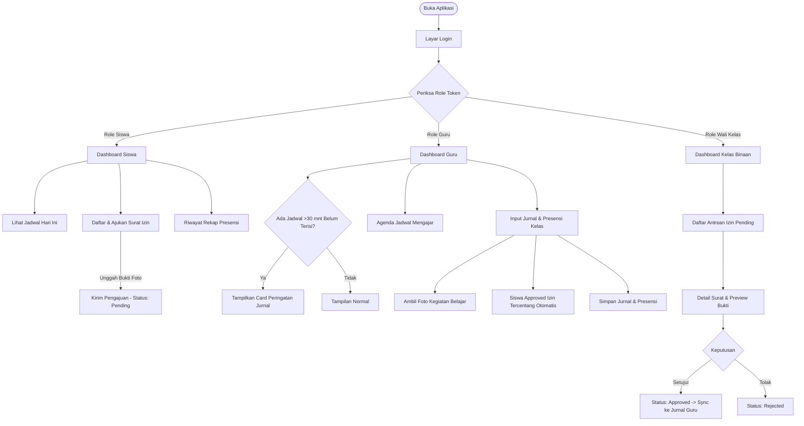

# 📱 PRODUCT REQUIREMENT DOCUMENT (PRD)
# School Class Progress (SCP) — Mobile Application
*Sistem Informasi Presensi, Jurnal Mengajar Guru, dan Perizinan Siswa Berbasis Siklus Jadwal Blok 2-Mingguan*

---

## 📑 Informasi Dokumen
- **Nama Proyek:** SCP Mobile (School Class Progress)
- **Kompetensi:** UKK SMK Rekayasa Perangkat Lunak (Paket 3)
- **Versi Dokumen:** 1.0.0
- **Status Dokumen:** Final / Ready for UI/UX Design & Development
- **Target Platform:** Mobile App (Android & iOS / Flutter / React Native / PWA)
- **Backend Integrasi:** Laravel 13 REST API with Laravel Sanctum Authentication
- **Target Audience:** UI/UX Designer, Mobile Frontend Developer, QA / Tester, Penguji UKK

---

## 1. Executive Summary & Problem Statement

### 1.1 Latar Belakang
Model pembelajaran Sekolah Menengah Kejuruan (SMK) yang menerapkan skema *Teaching Factory (TeFa)* menggunakan sistem **Jadwal Blok 2-Mingguan (Putaran 1 & Putaran 2)**. Pendataan jadwal, presensi siswa per jam tatap muka, pencatatan materi ajar guru, serta surat izin siswa membutuhkan aplikasi mobile yang portabel, cepat, dan mudah dioperasikan langsung di ruang kelas atau bengkel praktik.

### 1.2 Masalah yang Diselesaikan
1. **Presensi Manual Lambat & Rentan Miskomunikasi:** Guru mata pelajaran sering tidak mengetahui jika ada siswa yang izin sakit resmi karena surat fisik masih tertahan di wali kelas.
2. **Keterlambatan Pengisian Jurnal Mengajar:** Guru sering lupa mendokumentasikan kegiatan pembelajaran setelah jam kelas selesai.
3. **Kompleksitas Jadwal Blok:** Pergantian siklus *Putaran 1* dan *Putaran 2* membingungkan guru dan siswa jika tidak ada indikator visual yang jelas.
4. **Validasi Bentrok Jadwal Mandiri:** Guru membutuhkan sistem pencegah tabrakan ruangan, waktu, atau kelas saat menginput rencana jadwal mengajar.

---

## 2. User Persona & Hak Akses (Role-Based Access)

Aplikasi mobile dirancang dengan konsep **Single App Multi-Role** di mana navigasi dan antarmuka akan menyesuaikan secara dinamis sesuai role akun yang login.

```
┌─────────────────────────────────────────────────────────────────────────────┐
│                            SCP MOBILE SYSTEM                                │
├─────────────────────┬───────────────────────┬───────────────────────────────┤
│ 👨‍🎓 SISWA & ORTU    │ 👨‍🏫 GURU PENGAJAR     │ 👨‍💼 WALI KELAS & BK          │
├─────────────────────┼───────────────────────┼───────────────────────────────┤
│ • Ringkasan Hadir   │ • Dashboard & Alert   │ • Monitoring Kelas Binaan     │
│ • Jadwal Hari Ini   │ • Input Jurnal & Foto │ • Verifikasi Izin Siswa       │
│ • Riwayat Presensi  │ • Presensi Ter-Sync   │ • Preview Surat & Bukti Foto  │
│ • Pengajuan Izin    │ • Agenda Mengajar     │ • Rekap Kehadiran Siswa       │
│   (+Upload Surat)   │ • Input Jadwal Guru   │                               │
└─────────────────────┴───────────────────────┴───────────────────────────────┘
```

### Karakteristik Persona:
1. **Siswa & Orang Tua (`role: Siswa`)**
   - Mengakses lewat smartphone pribadi untuk melihat jadwal pelajaran aktif.
   - Mengajukan surat izin sakit/keperluan dengan mengambil foto surat keterangan dokter langsung dari kamera handphone.
   - Memantau persentase absensi bulanan dan riwayat keterlambatan/alpa.
2. **Guru Mata Pelajaran (`role: Guru` | `role: Guru BK`)**
   - Berada langsung di ruang kelas/lab praktik.
   - Memerlukan input cepat: ambil 1 foto suasana kelas, tulis materi pembelajaran, dan simpan presensi murid.
   - Menerima pengingat (*reminder*) jika belum mengisi jurnal setelah jam mengajar berakhir.
3. **Tim Kesiswaan (`role: Wali Kelas` | `role: Guru BK`)**
   - Bertanggung jawab memverifikasi keabsahan surat dokter/izin siswa binaan di kelasnya.
   - Memberikan keputusan persetujuan (*Approve*) atau penolakan (*Reject*).

---

## 3. 5 Aturan Bisnis Kunci (Business Logic Rules)

Lima aturan ini adalah **kunci kelulusan nilai tertinggi UKK** dan **wajib diwujudkan dalam komponen UI/UX**:

| No | Aturan Bisnis | Implementasi pada Desain UI/UX Mobile |
|:---|:---|:---|
| **1** | **Saklar Putaran Blok (Cycle Toggle)** | Terdapat *status pill* atau *sticky header card* di dashboard yang mengindikasikan status putaran aktif: `Putaran 1` atau `Putaran 2`. Seluruh tampilan jadwal harian otomatis mengikuti filter ini. |
| **2** | **Deteksi Bentrok Jadwal (Conflict Prevention)** | Saat guru menambah jadwal: jika terjadi irisan waktu (`Start_A < End_B AND End_A > Start_B`) pada hari, putaran, dan (ruang OR kelas OR guru) yang sama, UI wajib menampilkan dialog/bottom sheet peringatan bentrok secara spesifik. |
| **3** | **Kunci Jadwal (Lock Schedule)** | Jika Waka Kurikulum mengaktifkan status terkunci (`is_schedule_locked = true`), tombol `+ Tambah Jadwal` pada mobile guru dinonaktifkan (*disabled/hidden*) dan diberi pesan info *"Jadwal telah dikunci oleh Waka Kurikulum"*. |
| **4** | **Sinkronisasi Presensi Otomatis (Auto-Sync Approval)** | Saat guru membuka form presensi jurnal, siswa yang surat izinnya sudah disetujui (`Approved`) oleh wali kelas otomatis berstatus `Sakit`/`Izin` dengan label tag *"Tersinkronisasi dari Izin"*. |
| **5** | **Dashboard Alert Reminder (>30 Menit)** | Di dashboard guru, jika jam pelajaran telah lewat lebih dari 30 menit namun jurnal belum dibuat, tampilkan kartu alert merah/oranye dengan tombol CTA langsung: `Isi Jurnal Sekarang`. |

---

## 4. Information Architecture & User Flow

### 4.1 Diagram Alur Pengguna (User Flow)



### 4.2 Struktur Navigasi (Bottom Navigation Bar Dinamis)

#### Navigasi Siswa & Orang Tua:
- `[ 🏠 Beranda ]` : Statistik kehadiran bulan ini, jadwal hari ini, pengumuman.
- `[ 📅 Jadwal ]` : Jadwal pelajaran mingguan sesuai siklus blok aktif.
- `[ 📝 Perizinan ]` : Riwayat pengajuan izin & tombol ajukan surat baru.
- `[ 📊 Riwayat ]` : Detail catatan presensi per mata pelajaran & per bulan.
- `[ 👤 Profil ]` : Profil siswa, data kelas, ganti password, logout.

#### Navigasi Guru Pengajar:
- `[ 🏠 Beranda ]` : Jam aktif, jadwal mengajar hari ini, alert jurnal terlambat.
- `[ 📅 Jadwal ]` : Jadwal mengajar mingguan (Putaran 1 & 2), form tambah jadwal.
- `[ 📖 Jurnal ]` : Riwayat pengisian jurnal mengajar & catatan kelas.
- `[ 👤 Profil ]` : Identitas guru, NIP, ganti password, logout.

#### Navigasi Wali Kelas / Guru BK:
- `[ 🏠 Beranda ]` : Rekapitulasi absensi kelas hari ini, kartu izin pending.
- `[ 📋 Verifikasi ]` : Antrean verifikasi izin siswa (Pending, Approved, Rejected).
- `[ 👥 Siswa ]` : Daftar rekap presensi seluruh siswa di kelas binaan.
- `[ 👤 Profil ]` : Profil wali kelas, penugasan kelas, ganti password, logout.

---

## 5. Spesifikasi Layar Rinci (Screen Specifications)

### 5.1 Modul Global & Autentikasi

#### `SCR-01` Layar Splash & Autentikasi Awal
- **Elemen:** Logo SCP SMK, nama sekolah, animasi loading.
- **Fungsi:** Memeriksa token tersimpan di local storage / secure storage. Jika valid, langsung alihkan ke dashboard role terkait.

#### `SCR-02` Layar Login
- **Elemen:**
  - Input field *NISN / NIP / Username* dengan icon user.
  - Input field *Kata Sandi* dengan toggle eye icon (show/hide).
  - Checkbox *Ingat Saya*.
  - Tombol Utama `Masuk ke Sistem`.
  - Bantuan teknis / hubungi administrator sekolah.
- **Validasi:** Pesan error toast jika username atau password salah (HTTP 401).

#### `SCR-03` Layar Profil & Ganti Password
- **Elemen:**
  - Avatar lingkaran pengguna dengan tombol upload/ubah foto.
  - Kartu data diri: Nama Lengkap, Identitas (NISN/NIP), Role Badge, Kelas/Penugasan, Email, Nomor Telepon.
  - Tombol `Ubah Profil` (Nama, Email, No. HP, Foto).
  - Tombol `Ganti Password` (Password Lama, Password Baru, Konfirmasi Password Baru).
  - Tombol Merah `Keluar (Logout)` dengan dialog konfirmasi.

---

### 5.2 Modul Siswa & Orang Tua

#### `SCR-STU-01` Beranda Siswa
- **Header:** Ucapan selamat datang, nama siswa, foto profil, dan tag kelas (`XII RPL 1`).
- **Pill Indikator Putaran:** Menampilkan siklus aktif dan tanggal (cth: `Putaran 1 • Senin, 15 Oktober 2026`).
- **Widget Kehadiran Bulan Ini:**
  - Donut chart / Circular progress persentase kehadiran (cth: `96.5%`).
  - Grid 4 Kartu Metrik: `Hadir` (Hijau), `Sakit` (Kuning), `Izin` (Biru), `Alpa` (Merah).
- **Banner Status Izin:** Muncul jika ada pengajuan izin yang masih berstatus `Pending`.
- **Daftar Jadwal Hari Ini:** List card pelajaran hari ini (Mapel, Guru, Ruang, Jam).
- **Aksi Cepat:** Tombol shortcut `+ Ajukan Izin Baru`.

#### `SCR-STU-02` Jadwal Pelajaran Siswa
- **Pill Filter Hari:** Segment selector horizontal (`Senin`, `Selasa`, `Rabu`, `Kamis`, `Jumat`).
- **Card Mata Pelajaran:**
  - Judul Mapel (cth: *Pemrograman Web dan Perangkat Bergerak*).
  - Nama Guru Pengajar & NIP.
  - Waktu (`07:00 - 09:15`) dan Ruang Kelas (`Lab Komputer RPL 2`).
  - Status *Sedang Berlangsung* jika waktu saat ini berada di rentang jadwal tersebut.

#### `SCR-STU-03` Daftar Surat Perizinan Siswa
- **Tab Filter:** `Semua` | `Menunggu` | `Disetujui` | `Ditolak`.
- **Daftar Kartu Pengajuan:**
  - Badge Jenis: `Sakit` (Oranye) / `Izin` (Biru).
  - Rentang tanggal izin & total durasi (cth: `14 Okt - 15 Okt 2026 (2 Hari)`).
  - Badge status persetujuan: `Pending`, `Approved`, `Rejected`.
  - Keterangan nama verifikator (cth: *Diverifikasi oleh Bpk. Budi Santoso, S.Kom*).
- **FAB Button:** Tombol floating bulat `+ Ajukan Izin`.

#### `SCR-STU-04` Form Pengajuan Surat Izin Baru
- **Segmented Control:** Pilihan jenis izin `Sakit` atau `Izin Keperluan`.
- **Date Range Picker:** Tanggal Mulai dan Tanggal Selesai.
- **Input Textarea:** Alasan / Keterangan izin lengkap (maksimal 500 karakter).
- **Upload Box Bukti Dokumen:**
  - Pilihan sumber: Kamera Handphone langsung atau File Dokumen/Galeri.
  - Batas file: JPG, PNG, PDF (Maks. 2MB).
  - Preview thumbnail foto yang berhasil diunggah dengan opsi hapus/ganti.
- **Tombol Submit:** `Kirim Surat Izin`.

#### `SCR-STU-05` Riwayat Kehadiran Lengkap
- **Dropdown Filter:** Pilihan Bulan dan Tahun.
- **List Presensi Per Tanggal:**
  - Tanggal dan Jam pelajaran.
  - Mata Pelajaran dan Guru.
  - Badge Status: `Hadir`, `Izin`, `Sakit`, `Alpa`.
  - Catatan jika ada (cth: *"Izin dispensasi lomba LKS"*).

---

### 5.3 Modul Guru Mata Pelajaran

#### `SCR-TEA-01` Beranda Guru (Teacher Dashboard)
- **Header:** Nama guru, jam realtime, status siklus blok aktif (`Putaran 1 / Putaran 2`).
- **CRITICAL ALERT CARD (Pengingat Jurnal Terlambat):**
  - Tampil di bagian paling atas jika ada jadwal guru hari ini yang selesai >30 menit lalu dan belum diisi jurnalnya.
  - Desain: Card merah bergaris peringatan dengan icon lonceng bergetar.
  - Teks: *"Perhatian: Jurnal mengajar untuk kelas XII RPL 1 (Basis Data) belum diisi (>30 menit selesai)"*.
  - Tombol: `Isi Jurnal Sekarang`.
- **Daftar Kelas Mengajar Hari Ini:**
  - Card sesi mengajar dengan badge status: `Sudah Terisi` (Hijau) / `Belum Diisi` (Abu-abu).
  - Tombol aksi cepat: `Buka Kelas / Isi Jurnal`.
- **Info Kunci Jadwal:** Banner kecil penanda apakah jadwal dalam kondisi terkunci oleh Waka Kurikulum.

#### `SCR-TEA-02` Jadwal Mengajar Guru
- **Tab Hari:** `Senin` sampai `Jumat`.
- **Filter Putaran:** Pilihan `Putaran 1` atau `Putaran 2`.
- **List Jadwal:** Rincian jam mengajar, kelas, mapel, dan ruangan.
- **Tombol `+ Tambah Jadwal`:**
  - Aktif jika `is_schedule_locked = false`.
  - Dinonaktifkan dengan banner informasi jika `is_schedule_locked = true`.

#### `SCR-TEA-03` Form Tambah Jadwal Mandiri Guru
- **Pilihan:**
  - Hari (`Senin - Jumat`).
  - Siklus (`Putaran 1` / `Putaran 2`).
  - Dropdown Kelas, Dropdown Ruang, Dropdown Mata Pelajaran.
  - Time Picker: Jam Mulai & Jam Selesai (durasi jam otomatis terhitung).
- **Bottom Sheet Peringatan Bentrok:**
  - Muncul jika jadwal tabrakan dengan jadwal guru lain / ruang lain.
  - Merinci alasan tabrakan secara spesifik: Guru bersangkutan, Ruang yang bentrok, atau Kelas yang sedang dipakai.

#### `SCR-TEA-04` Form Input Jurnal & Presensi Kelas (Core Experience)
- **Header Ringkasan Kelas:** Mapel, Kelas, Ruang, Jam, Tanggal Hari Ini.
- **Bagian 1: Jurnal Pembelajaran**
  - Textarea: *Materi & Topik Pembelajaran* (Wajib diisi).
  - Textarea: *Catatan Tambahan / Kendala Siswa* (Opsional).
  - **Tombol Kamera Kegiatan:**
    - Membuka kamera smartphone secara realtime.
    - Menampilkan preview foto kegiatan pembelajaran di dalam kelas (Maks. 3MB).
- **Bagian 2: Checklist Presensi Siswa**
  - List seluruh siswa di kelas tersebut (Foto, Nama, NISN).
  - Selector 4 Opsi Status: `H` (Hadir), `I` (Izin), `S` (Sakit), `A` (Alpa).
  - **Auto-Sync Tag:** Jika siswa sudah memiliki izin yang di-*Approve* wali kelas pada tanggal tersebut, otomatis terpilih `I`/`S` dan muncul badge *"Izin Disetujui"*. Guru tetap dapat mengubah jika siswa ternyata hadir.
  - Input catatan kecil per siswa (cth: *"Terlambat 10 menit"*).
- **Tombol Simpan:** Sticky bar di bagian bawah bertuliskan `Simpan Jurnal & Presensi Kelas`.

#### `SCR-TEA-05` Riwayat Jurnal Guru
- **Filter:** Bulan, Tahun, dan Putaran Siklus.
- **Card Jurnal:** Foto bukti mengajar, tanggal, nama mapel, kelas, ringkasan materi, jumlah siswa hadir/tidak hadir, dan tombol untuk melihat rincian presensi.

---

### 5.4 Modul Wali Kelas & Tim Kesiswaan (BK)

#### `SCR-HOM-01` Beranda Wali Kelas
- **Header:** Nama Wali Kelas & Label Kelas Binaan (`Wali Kelas: XII RPL 1`).
- **Ringkasan Kehadiran Hari Ini:**
  - Persentase kehadiran kelas.
  - Metrik: Total Siswa, Hadir, Izin, Sakit, Alpa.
- **Card Pengingat Verifikasi Izin:**
  - Menampilkan jumlah izin yang menunggu tindakan (cth: *"3 Surat Izin Perlu Diverifikasi"*).
  - Tombol CTA: `Buka Antrean Verifikasi`.

#### `SCR-HOM-02` Daftar Verifikasi Izin Siswa
- **Segmented Control:** `Menunggu (Pending)` | `Disetujui (Approved)` | `Ditolak (Rejected)`.
- **Search Bar:** Cari nama siswa atau NISN.
- **Card Permintaan Izin:**
  - Nama siswa & foto profil.
  - Alasan izin (`Sakit` / `Izin Urusan Keluarga`).
  - Rentang tanggal & durasi.
  - Cuplikan deskripsi alasan.
  - Tombol: `Tinjau Surat`.

#### `SCR-HOM-03` Modal Detail & Aksi Verifikasi Surat
- **Tampilan:**
  - Profil lengkap siswa & nomor kontak orang tua.
  - Tanggal pengajuan & rentang izin.
  - Alasan lengkap tertulis.
  - **Pratinjau Dokumen:** Foto surat dokter / surat keterangan dengan kemampuan *tap-to-zoom* / fullscreen modal.
  - **Aksi Keputusan:**
    - Tombol Hijau: `Setujui (Approve)` -> Muncul konfirmasi; setelah disetujui, presensi otomatis terisi Sakit/Izin di jurnal guru.
    - Tombol Merah: `Tolak (Reject)` -> Input catatan alasan penolakan.

---

## 6. Pemetaan REST API Backend ke Layar Mobile

Daftar endpoint backend Laravel Sanctum yang digunakan oleh masing-masing layar:

| Layar / Fitur Mobile | Endpoint Backend | HTTP Method | Header & Body Params |
|:---|:---|:---:|:---|
| **Login** (`SCR-02`) | `/api/login` | `POST` | `username` / `identity_number`, `password` |
| **Get Profil** (`SCR-03`) | `/api/me` | `GET` | `Bearer Token` |
| **Update Profil** (`SCR-03`) | `/api/profile` | `PUT` | `full_name`, `phone`, `email`, `profile_photo` |
| **Ganti Password** (`SCR-03`) | `/api/profile/password` | `PUT` | `current_password`, `new_password` |
| **Dropdown Referensi** | `/api/references/classrooms`<br>`/api/references/rooms`<br>`/api/references/subjects` | `GET` | Mengambil data referensi untuk form |
| **Dashboard Siswa** (`SCR-STU-01`) | `/api/student/dashboard` | `GET` | Summary hadir/sakit/izin/alpa, jadwal hari ini |
| **Jadwal Siswa Hari Ini** (`SCR-STU-02`) | `/api/student/schedules/today` | `GET` | Jadwal hari ini berdasarkan putaran aktif |
| **Riwayat Presensi** (`SCR-STU-05`) | `/api/student/attendance-history` | `GET` | Query params: `month`, `year`, `page` |
| **List Izin Siswa** (`SCR-STU-03`) | `/api/student/leave-requests` | `GET` | Riwayat izin milik siswa bersangkutan |
| **Kirim Izin Siswa** (`SCR-STU-04`) | `/api/student/leave-requests` | `POST` | `multipart/form-data`: `start_date`, `end_date`, `reason_type`, `description`, `attachment_photo` |
| **Dashboard Guru** (`SCR-TEA-01`) | `/api/teacher/dashboard` | `GET` | Jadwal hari ini, status kunci, dan **daftar pending alert jurnal terlambat** |
| **Jadwal Guru Mingguan** (`SCR-TEA-02`) | `/api/teacher/schedules` | `GET` | Query params: `cycle_type`, `classroom_id` |
| **Tambah Jadwal Guru** (`SCR-TEA-03`) | `/api/teacher/schedules` | `POST` | `day_of_week`, `start_time`, `end_time`, `classroom_id`, `room_id`, `subject_id`, `cycle_type` |
| **Daftar Siswa Kelas** (`SCR-TEA-04`) | `/api/teacher/schedules/{id}/students` | `GET` | List siswa di jadwal tersebut + flag `has_approved_leave` |
| **Simpan Jurnal & Absensi** (`SCR-TEA-04`) | `/api/teacher/journals` | `POST` | `multipart/form-data`: `schedule_id`, `date`, `teaching_material`, `notes`, `activity_photo`, `attendances[...]` |
| **Riwayat Jurnal Guru** (`SCR-TEA-05`) | `/api/teacher/journals` | `GET` | Query params: `month`, `year`, `cycle_type`, `page` |
| **Dashboard Wali Kelas** (`SCR-HOM-01`) | `/api/homeroom/dashboard` | `GET` | Statistik kehadiran kelas binaan hari ini |
| **List Izin Kelas** (`SCR-HOM-02`) | `/api/homeroom/leave-requests` | `GET` | Query params: `status`, `page` |
| **Detail Izin Siswa** (`SCR-HOM-03`) | `/api/homeroom/leave-requests/{id}` | `GET` | Detail data izin dan URL foto lampiran |
| **Verifikasi Izin** (`SCR-HOM-03`) | `/api/homeroom/leave-requests/{id}/verify` | `PUT` | `status: "Approved"|"Rejected"`, `notes` |

---

## 7. Desain Sistem & Panduan UI/UX

### 7.1 Palet Warna Utama (Color Tokens)
- **Primary Indigo:** `#1E3A8A` (Deep Royal Blue) — Warna dominan navigasi, tombol primer, dan identitas resmi.
- **Secondary Teal:** `#0D9488` (Teal) — Warna aksen interaktif, highlight jadwal aktif.
- **Background:** `#F8FAFC` (Slate Light 50) — Latar belakang aplikasi yang bersih dan nyaman di mata.
- **Surface / Card:** `#FFFFFF` — Latar belakang kartu dengan bayangan halus (`box-shadow: 0 2px 8px rgba(0,0,0,0.06)`).

### 7.2 Semantic Status Colors
- **Status Kehadiran:**
  - `Hadir` : Emerald Green (`#10B981`)
  - `Izin` : Sky Blue (`#0284C7`)
  - `Sakit` : Warm Amber (`#F59E0B`)
  - `Alpa` : Crimson Red (`#EF4444`)
- **Status Persetujuan Izin:**
  - `Pending` : Amber Pill (`#FEF3C7` teks `#B45309`)
  - `Approved` : Green Pill (`#D1FAE5` teks `#065F46`)
  - `Rejected` : Red Pill (`#FEE2E2` teks `#991B1B`)

### 7.3 Tipografi
- **Font Rekomendasi:** *Plus Jakarta Sans* atau *Inter* (Google Fonts).
- **Scale:**
  - Heading 1 (Greeting & Title): `20px` Bold
  - Heading 2 (Card Title & Modal Title): `16px` SemiBold
  - Body Text: `14px` Regular
  - Caption / Time / Badge: `12px` Medium
  - Small Indicator: `10px` SemiBold

### 7.4 Ergonomi Mobile & Layar Sentuh
1. **Zona Jempol (Thumb-Zone Optimization):** Tempatkan tombol submit utama (seperti *Simpan Jurnal* atau *Kirim Izin*) di bagian bawah layar (*sticky bottom container*).
2. **Bottom Sheet Dialogs:** Gunakan komponen bottom-sheet untuk opsi seleksi cepat, dialog konfirmasi approve, dan rincian bentrok jadwal.
3. **Optimasi Foto Realtime:** Komponen kamera harus membuka jendela viewfinder cepat dengan rasio 4:3 / 1:1 dan pratinjau instan.
4. **Pull-to-Refresh & Shimmer:** Wajib ada animasi tarik-ke-bawah (*swipe to refresh*) di semua layar daftar dan *shimmer skeleton loader* saat data sedang diambil dari backend.

---

## 8. Skenario Khusus & Edge Cases

| Kasus Khusus | Skenario Kondisi | Perilaku Desain Antarmuka |
|:---|:---|:---|
| **1. Jadwal Terkunci** | Waka mengaktifkan *Lock Schedule* | Pada layar jadwal guru, sembunyikan tombol `+ Tambah Jadwal`. Tampilkan kartu info netral: *"Jadwal saat ini dikunci oleh Waka Kurikulum"*. |
| **2. Bentrok Jadwal** | Guru menginput jam/ruang yang bertabrakan | Munculkan *Bottom Sheet Alert* merah berisi informasi detail: jadwal guru lain yang sudah menempati ruangan dan kelas tersebut. |
| **3. Offline / Jaringan Putus** | Koneksi hilang saat kirim jurnal/izin | Tampilkan bar merah di atas layar *"Koneksi terputus. Data Anda tidak hilang."* dengan tombol `Coba Kirim Ulang`. |
| **4. Ukuran Foto Berlebih** | User upload foto kamera resolusi tinggi (>5MB) | Aplikasi mobile melakukan kompresi otomatis di sisi klien (*client-side compression*) menjadi maksimal 1.5MB sebelum diunggah ke API. |
| **5. Jurnal Terlambat >30 Menit** | Waktu saat ini > `end_time` + 30 menit | Card merah peringatan mendominasi bagian atas beranda guru. Tombol langsung mengarahkan ke form jurnal untuk jadwal tersebut. |

---

## 9. Checklist Rencana Pengerjaan Desain (Design Deliverables)

- [ ] **Wireframe & Sketsa User Flow:**
  - [ ] Alur Login & Pemilihan Role
  - [ ] Alur Guru: Buka Dashboard ➔ Klik Alert Jurnal ➔ Ambil Foto ➔ Simpan Presensi
  - [ ] Alur Siswa: Ajukan Izin ➔ Ambil Foto Surat ➔ Cek Status Pending
  - [ ] Alur Wali Kelas: Buka Antrean Izin ➔ Zoom Surat Dokter ➔ Klik Approve
- [ ] **Design System & UI Kit:**
  - [ ] Token Warna, Tipografi, Shadow, dan Radius
  - [ ] Komponen Badge Kehadiran (`H`, `I`, `S`, `A`)
  - [ ] Komponen Card Jadwal dengan indikator Putaran 1 / Putaran 2
  - [ ] Komponen Card Alert Reminder Keterlambatan
- [ ] **High-Fidelity Mockups (Figma):**
  - [ ] Antarmuka Siswa & Orang Tua (5 Layar)
  - [ ] Antarmuka Guru Mata Pelajaran (5 Layar)
  - [ ] Antarmuka Wali Kelas & Guru BK (3 Layar)
- [ ] **Interactive Prototype:**
  - [ ] Simulasi klik tombol Approve perizinan
  - [ ] Simulasi deteksi bentrok jadwal
  - [ ] Simulasi pengisian jurnal dan checklist presensi siswa

---
*Dokumen ini merupakan acuan resmi pengembangan mobile School Class Progress (SCP SMK). Disusun selaras dengan database migration, model observer, dan controller API yang aktif.*
