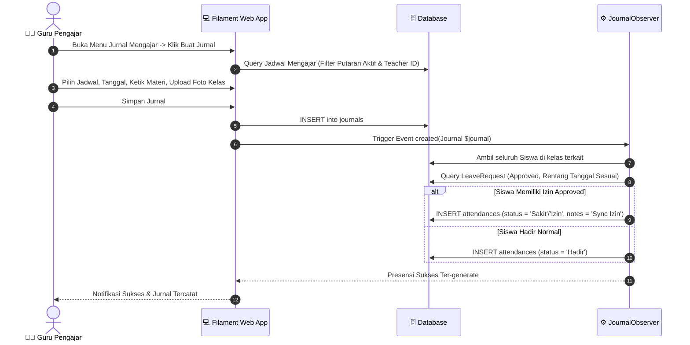
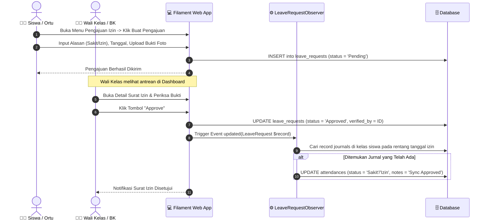
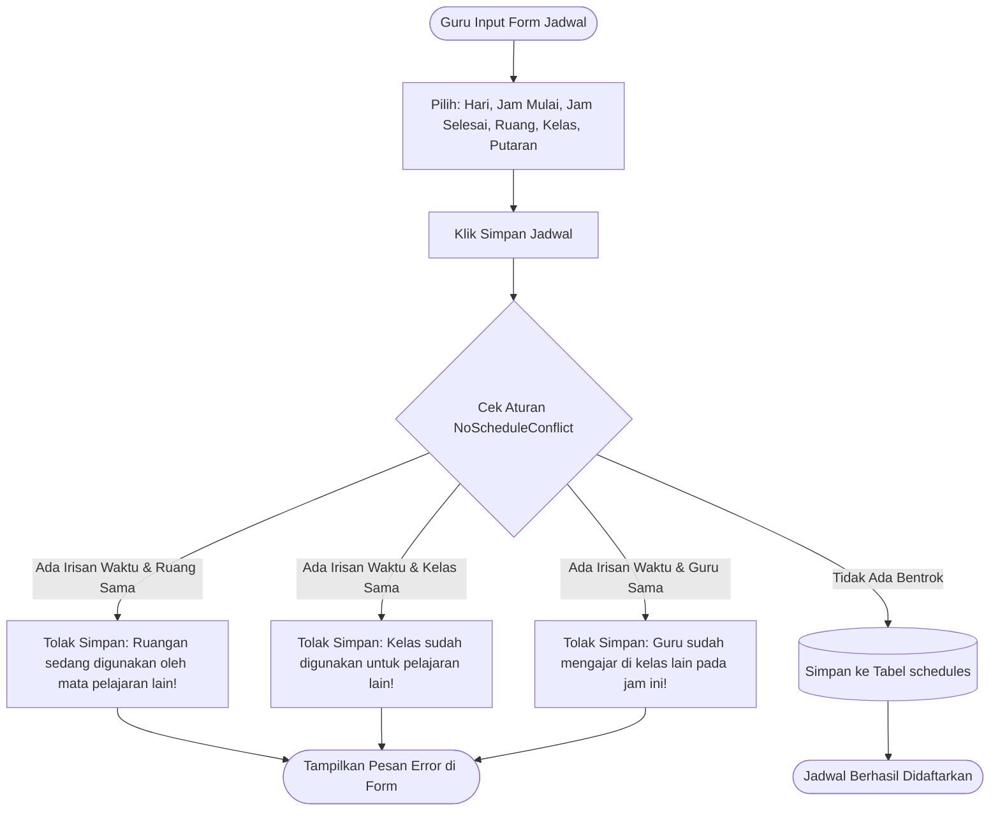

# 📄 PRODUCT REQUIREMENT DOCUMENT (PRD)
# School Class Progress (SCP) — Web Application (Filament & Laravel 13)
*Sistem Informasi Presensi, Jurnal Mengajar Guru, dan Perizinan Siswa Berbasis Siklus Jadwal Blok 2-Mingguan*

---

## 📑 Informasi Dokumen
- **Nama Proyek:** School Class Progress (SCP) Web Platform
- **Kompetensi Keahlian:** Rekayasa Perangkat Lunak (RPL) — Uji Kompetensi Keahlian (UKK) 2026 Paket 3
- **Versi Dokumen:** 1.0.0
- **Status Dokumen:** Approved / Production-Ready
- **Platform:** Web Application (Responsive Desktop & Mobile Browser)
- **Teknologi Utama:** 
  - Framework Backend: Laravel 13.x (PHP 8.3+)
  - Admin & Operation Panel: Filament v4 / v5 (Livewire 3 + Alpine.js + TailwindCSS)
  - Otentikasi & RBAC: Laravel Session & Spatie Laravel-Permission / Filament Shield
  - Basis Data: MySQL / MariaDB (Relational DBMS)
  - API Gateway: Laravel Sanctum (Token-based Auth untuk SCP Mobile)
- **Target Pembaca:** Tim Penguji UKK, Guru Pembimbing, Fullstack Developer, System Architect, UI/UX Designer, QA Engineer.

---

## 1. Executive Summary & Problem Statement

### 1.1 Latar Belakang
Sekolah Menengah Kejuruan (SMK) yang menerapkan model pembelajaran **Teaching Factory (TeFa)** dan Kurikulum Merdeka kerap mengadopsi model **Jadwal Blok 2-Mingguan (Putaran 1 & Putaran 2)**. Pada skema ini, rombongan belajar (rombel) bergantian antara pembelajaran teori umum dan praktik bengkel/laboratorium intensif setiap dua minggu sekali. 

Tantangan utama yang dihadapi sekolah adalah kompleksitas pengelolaan jadwal pelajaran, pencatatan jurnal mengajar guru yang akuntabel, serta pengelolaan presensi siswa yang sering kali terlambat disinkronkan dengan perizinan sakit/izin resmi dari orang tua.

Aplikasi web **School Class Progress (SCP)** dirancang sebagai pusat kendali operasional (*command center*) sekolah yang menggabungkan kemudahan entri data harian guru, otomasi sinkronisasi absensi, validasi tabrakan ruangan/waktu, dan pemantauan manajerial oleh Waka Kurikulum serta Wali Kelas secara realtime.

### 1.2 Masalah yang Diselesaikan
1. **Tabrakan Jadwal Mengajar (Schedule Overlap):** Sering terjadi bentrok pemakaian ruangan praktik, jam mengajar guru, atau penggunaan kelas saat penyusunan jadwal.
2. **Keterlambatan Dokumentasi Jurnal:** Guru sering menunda pengisian materi dan bukti fisik pembelajaran di kelas hingga berminggu-minggu.
3. **Miskomunikasi Status Kehadiran:** Siswa yang sudah mengantongi surat keterangan sakit dari dokter sering kali tetap ditandai 'Alpa' di kelas oleh guru mata pelajaran karena belum ada rekonsiliasi data perizinan.
4. **Kesulitan Perubahan Siklus Blok:** Pergantian minggu antara Putaran 1 dan Putaran 2 menuntut pemilahan jadwal manual yang berisiko salah lihat agenda.
5. **Ketiadaan Rekapitulasi Presensi Siap Cetak:** Wali kelas dan Waka Kurikulum membutuhkan waktu lama untuk menghitung persentase kehadiran dan mencetak laporan resmi bulanan.

---

## 2. Tujuan & Sasaran Produk (Product Goals)

| Goal ID | Deskripsi Sasaran | Metrik Keberhasilan |
| :--- | :--- | :--- |
| **G-01** | Mengotomatisasi validasi pencegahan jadwal bentrok secara mutlak. | 0% bentrok ruang, guru, dan kelas pada hari dan siklus yang sama. |
| **G-02** | Menyediakan saklar global siklus blok 2-mingguan (*Cycle Toggle*). | Perubahan putaran aktif langsung memfilter seluruh tampilan operasional sekolah. |
| **G-03** | Memfasilitasi jurnal harian realtime dilengkapi upload bukti foto kelas. | Guru wajib mengunggah foto aktivitas nyata saat submit jurnal materi. |
| **G-04** | Mengintegrasikan izin siswa yang disetujui (*Approved*) ke presensi jurnal secara realtime (*Auto-Sync*). | Status presensi siswa otomatis berubah menjadi 'Sakit'/'Izin' tanpa input ganda. |
| **G-05** | Memberikan peringatan (*dashboard alert*) untuk kelas yang selesai tanpa jurnal terisi. | Banner peringatan muncul di dashboard guru jika jadwal lewat >30 menit. |
| **G-06** | Menyediakan fitur import massal jadwal pelajaran dari Excel/PDF/CSV. | Mampu memproses puluhan jadwal dan mendaftarkan akun guru baru sekaligus. |
| **G-07** | Menyediakan modul rekapitulasi dan cetak laporan presensi format cetak resmi. | Menghitung kalkulasi Hadir, Sakit, Izin, Alpa, % Kehadiran dan siap dicetak/PDF. |

---

## 3. User Persona & Role-Based Access Control (RBAC)

Sistem SCP mengimplementasikan RBAC terpusat dengan 6 role pengguna:

```
┌─────────────────────────────────────────────────────────────────────────────┐
│                          SCHOOL CLASS PROGRESS (SCP)                        │
├─────────────────────┬───────────────────────┬───────────────────────────────┤
│ 🛡️ SUPER ADMIN      │ 🎓 WAKA KURIKULUM     │ 👨‍🏫 GURU PENGAJAR             │
│ • Kontrol Penuh     │ • Master Data Sekolah │ • Input Jadwal Mandiri        │
│ • Manajemen Role    │ • Toggle Putaran Blok │ • Input Jurnal & Bukti Foto   │
│ • Audit Log & Users │ • Kunci Jadwal (Lock) │ • Pengingat Keterlambatan     │
├─────────────────────┼───────────────────────┼───────────────────────────────┤
│ 👨‍💼 WALI KELAS       │ 🧑‍⚕️ GURU BK          │ 👨‍🎓 SISWA & ORANG TUA         │
│ • Verifikasi Izin   │ • Verifikasi Izin     │ • Portal Izin / Sakit Online  │
│ • Monitoring Rombel │ • Rekap Konseling     │ • Upload Bukti Surat Dokter   │
│ • Cetak Rekap Absen │ • Pantau Siswa Alpa   │ • Widget Kehadiran Pribadi    │
└─────────────────────┴───────────────────────┴───────────────────────────────┘
```

### 3.1 Karakteristik Persona & Kebutuhan Pengguna

1. **Super Admin (`Super Admin`)**
   - Mengelola sistem secara menyeluruh, konfigurasi framework, izin akses Shield, dan manajemen akun pengguna.
2. **Waka Kurikulum (`Waka Kurikulum`)**
   - Bertanggung jawab atas kalender akademik, master kelas, ruangan, mata pelajaran, dan tahun ajaran aktif.
   - Mengatur saklar putaran blok (`Putaran 1` / `Putaran 2`).
   - Melakukan penguncian jadwal (*Lock Schedule*) setelah masa penyusunan jadwal selesai.
   - Memantau kepatuhan guru dalam mengisi jurnal mengajar harian.
3. **Guru Mata Pelajaran (`Guru`)**
   - Menginput jadwal mengajar mandiri sesuai Surat Keputusan (SK) pembagian tugas.
   - Mengisi jurnal mengajar harian, merangkum capaian materi, dan mengunggah foto suasana kelas.
   - Melihat daftar presensi siswa yang telah terisi otomatis (Hadir default, atau Sakit/Izin bagi yang telah disetujui).
4. **Wali Kelas (`Wali Kelas`)**
   - Mengawasi kehadiran siswa di rombel binaannya.
   - Memeriksa keabsahan surat permohonan izin/sakit yang diajukan siswa dan memberikan approval/rejection.
   - Melihat dan mencetak laporan rekapitulasi presensi bulanan/semester kelas binaan.
5. **Guru Bimbingan Konseling (`Guru BK`)**
   - Memantau data ketidakhadiran siswa di seluruh kelas.
   - Memantau siswa rawan (Alpa ≥ 3 kali dalam satu bulan berjalan) untuk ditindaklanjuti dengan pemanggilan/konseling.
   - Memiliki wewenang memvalidasi surat izin siswa dari sisi kesiswaan.
6. **Siswa & Orang Tua (`Siswa`)**
   - Mengakses portal dengan NISN untuk melihat ringkasan rekap kehadiran dan persentase kehadiran.
   - Mengajukan permohonan izin (Sakit, Izin Urusan Keluarga, Pulang Cepat, atau Kegiatan Luar Sekolah) disertai unggah berkas surat dokter/surat pernyataan.

---

### 3.2 Matriks Hak Akses Fitur (Feature Permissions Matrix)

| Modul / Fitur Sistem | Super Admin | Waka Kurikulum | Guru | Wali Kelas | Guru BK | Siswa/Ortu |
| :--- | :---: | :---: | :---: | :---: | :---: | :---: |
| **Login Dual Identitas (NISN / NIP / User)** | ✔ | ✔ | ✔ | ✔ | ✔ | ✔ |
| **Edit Profil & Ganti Password** | ✔ | ✔ | ✔ | ✔ | ✔ | ✔ |
| **Kelola Master Data (Kelas, Ruang, Mapel, TA)** | ✔ | ✔ | ❌ | ❌ | ❌ | ❌ |
| **Kelola Pengguna (Users & Roles)** | ✔ | ✔ (User saja) | ❌ | ❌ | ❌ | ❌ |
| **Saklar Putaran Blok (Cycle Toggle)** | ✔ | ✔ | ❌ | ❌ | ❌ | ❌ |
| **Kunci Jadwal Pelajaran (Lock Schedule)** | ✔ | ✔ | ❌ | ❌ | ❌ | ❌ |
| **Import Massal Jadwal (Excel / PDF / CSV)** | ✔ | ✔ | ✔ (Milik sendiri) | ❌ | ❌ | ❌ |
| **Input Jadwal Mandiri (+Cek Bentrok Otomatis)**| ✔ | ✔ | ✔ (Hanya saat Unlock)| ❌ | ❌ | ❌ |
| **Input Jurnal Mengajar (+Upload Foto Realtime)**| ✔ | ✔ (View) | ✔ (Create & Edit) | ❌ | ❌ | ❌ |
| **Pengajuan Surat Izin (+Upload Bukti)** | ✔ | ❌ | ❌ | ✔ (Bantuan siswa)| ❌ | ✔ |
| **Verifikasi / Approval Surat Izin** | ✔ | ❌ | ❌ | ✔ | ✔ | ❌ |
| **Dashboard Alert Jurnal Belum Diisi (>30 Mnt)**| ✔ | ✔ (Semua Guru) | ✔ (Jadwal Sendiri)| ❌ | ❌ | ❌ |
| **Widget Statistik & Monitoring Khusus** | ✔ | ✔ (Waka Stats)| ✔ (Teacher Stats) | ✔ (Homeroom Stats)| ✔ (BK Stats)| ✔ (Student Stat)|
| **Laporan Rekap Presensi & Cetak Print Layout**| ✔ | ✔ | ✔ (Kelasnya) | ✔ (Kelas Binaan)| ✔ | ❌ |
| **Akses REST API Mobile (Laravel Sanctum)** | ✔ | ❌ | ✔ | ✔ | ✔ | ✔ |

---

## 4. 5 Logika Bisnis Utama (The 5 UKK Pillars)

Lima aturan bisnis berikut merupakan **persyaratan mutlak kelulusan nilai tertinggi UKK RPL Paket 3 2026**:

### 4.1 Logika 1: Anti-Tabrakan Waktu (Conflict Prevention)
* **Aturan:** Guru dilarang membuat jadwal yang saling tumpang tindih waktu pada siklus putaran dan hari yang sama.
* **Kriteria Irisan Waktu (Overlap Formula):**
  $$\text{Bentrok} \iff (\text{Start}_A < \text{End}_B) \land (\text{End}_A > \text{Start}_B)$$
* **Dimensi Pengecekan:**
  1. **Ruangan (`room_id`):** Ruangan yang sama tidak boleh dipakai oleh 2 kelas berbeda pada jam beririsan.
  2. **Kelas (`classroom_id`):** Kelas yang sama tidak boleh menerima pelajaran dari 2 guru/mapel berbeda pada jam beririsan.
  3. **Guru (`teacher_id`):** Guru yang sama tidak boleh mengajar di 2 kelas atau ruangan berbeda pada jam beririsan.
* **Implementasi Kode:** `App\Rules\NoScheduleConflict.php` yang dipasang langsung pada *schema component rules* di Filament Form dan Request API. Memberikan pesan galat spesifik mata pelajaran mana yang bertabrakan.

### 4.2 Logika 2: Saklar Putaran Blok (Cycle Toggle)
* **Aturan:** Sekolah menggunakan skema blok 2 mingguan. Waka Kurikulum dapat mengganti putaran aktif antara **Putaran 1** dan **Putaran 2** dengan satu kali klik.
* **Dampak Sistemik:**
  - `SystemConfiguration::current()->active_cycle` diperbarui.
  - Widget dashboard dan tabel jadwal secara global otomatis menyaring data mengikuti putaran aktif tanpa perlu me-reload filter manual.
  - Form entri jurnal guru hanya menampilkan jadwal yang sesuai dengan putaran yang sedang aktif.
* **Implementasi Kode:** `App\Filament\Widgets\SystemConfigWidget.php` dengan method `toggleCycleAction()`.

### 4.3 Logika 3: Mekanisme Kunci Jadwal (Lock Schedule)
* **Aturan:** Setelah batas waktu input jadwal mandiri guru berakhir, Waka Kurikulum mengaktifkan status terkunci (`is_schedule_locked = true`).
* **Dampak Sistemik:**
  - Hak akses `create`, `update`, dan `delete` pada resource jadwal bagi role **Guru** dinonaktifkan di backend (`SchedulePolicy.php`) dan tombol disembunyikan di frontend.
  - Pada API mobile, endpoint `POST /api/teacher/schedules` merespons error `403 Forbidden` dengan pesan: *"Jadwal pelajaran telah dikunci oleh Waka Kurikulum"*.
* **Implementasi Kode:** `App\Filament\Widgets\SystemConfigWidget.php` dengan method `toggleLockAction()` dan verifikasi di `App\Policies\SchedulePolicy.php`.

### 4.4 Logika 4: Alur Sinkronisasi Presensi Otomatis (Two-Way Auto-Sync)
* **Aturan:** Presensi siswa tidak boleh diisi manual secara terpisah dari perizinan. Presensi harus terintegrasi dua arah dengan surat izin yang disetujui.
* **Alur Dua Arah:**
  1. **Arah 1 (Jurnal Dibuat $\rightarrow$ Tarik Izin):**
     Saat guru membuka form jurnal dan menyimpannya, `JournalObserver::created()` secara otomatis mencari semua siswa di kelas tersebut. Siswa yang memiliki pengajuan izin `Approved` pada tanggal tersebut otomatis dibuatkan record presensi berstatus `Sakit` atau `Izin`. Siswa lainnya otomatis berstatus `Hadir`.
  2. **Arah 2 (Izin Disetujui Belakangan $\rightarrow$ Update Presensi):**
     Jika jurnal sudah dibuat pagi hari berstatus 'Hadir', namun siangnya Wali Kelas menyetujui surat dokter siswa, `LeaveRequestObserver::updated()` secara otomatis memperbarui record `attendances` siswa tersebut pada tanggal terkait menjadi `Sakit` / `Izin`.
* **Implementasi Kode:** `App\Observers\JournalObserver.php` dan `App\Observers\LeaveRequestObserver.php`.

### 4.5 Logika 5: Dashboard Alert Reminder Keterlambatan Jurnal (>30 Menit)
* **Aturan:** Sistem harus mendeteksi secara *realtime* (saat halaman dimuat, **tanpa background cron job**) jika ada jadwal mengajar guru pada hari ini yang telah selesai lebih dari 30 menit, namun belum dibuatkan jurnal.
* **Perhitungan Waktu:**
  $$\text{Terlambat} \iff \text{Hari Ini} = \text{day\_of\_week} \land \text{end\_time} < (\text{CurrentTime} - 30\text{ menit}) \land \text{Tidak Memiliki Journal Hari Ini}$$
* **Antarmuka:** Menampilkan banner peringatan berwarna merah/kuning di puncak dashboard guru beserta informasi mapel, kelas, jam mengajar, dan tombol aksi langsung *"Isi Jurnal Sekarang"*. Super Admin dan Waka Kurikulum dapat melihat daftar seluruh guru yang menunggak jurnal.
* **Implementasi Kode:** `App\Filament\Widgets\UnfilledJournalAlertWidget.php`.

---

## 5. Rincian Kebutuhan Fungsional (Functional Specifications)

### 5.1 Modul Otentikasi & Profil Pengguna
- **F-AUTH-01: Dual Identity Login Form:** Pengguna dapat masuk menggunakan NISN (untuk Siswa) atau NIP/Username (untuk Guru & Tenaga Kependidikan) dengan satu field input dinamis.
- **F-AUTH-02: Role Redirection:** Sistem mengarahkan pengguna langsung ke panel dashboard Filament yang sesuai dengan hak aksesnya.
- **F-AUTH-03: Manajemen Profil Mandiri:** Halaman `EditProfile` kustom yang menampilkan kartu profil visual (*hero profile card*), form ubah nama, email, nomor HP, foto profil avatar, serta validasi ganti password aman.
- **F-AUTH-04: Session Security:** Otomatis logout saat sesi kedaluwarsa, proteksi CSRF, dan enkripsi cookie.

### 5.2 Modul Master Data Sekolah (Waka Kurikulum & Super Admin)
- **F-MAST-01: Manajemen Kelas (`Classrooms`):** CRUD rombel belajar (contoh: XII RPL 1, XII RPL 2).
- **F-MAST-02: Manajemen Ruangan (`Rooms`):** CRUD lab praktik dan ruang teori (contoh: Lab 16 RPL, Lab 18 RPL, Ruang 13 Normada).
- **F-MAST-03: Manajemen Mata Pelajaran (`Subjects`):** Standardisasi nama mata pelajaran kejuruan dan umum.
- **F-MAST-04: Manajemen Tahun Ajaran (`AcademicYears`):** Pengaturan semester dan tahun ajaran aktif (contoh: 2026/2027 Ganjil/Genap).
- **F-MAST-05: Manajemen Pengguna (`Users`):** Pembuatan akun guru, wali kelas, guru BK, siswa, serta asosiasi relasi kelas binaan via tabel pivot `user_class`.

### 5.3 Modul Penjadwalan Pelajaran (`Schedules`)
- **F-SCHD-01: Form Input Jadwal Mandiri:** Pemilihan mata pelajaran, kelas, ruangan, hari (Senin–Jumat), jam mulai, jam selesai, dan putaran siklus (`Putaran 1` / `Putaran 2`).
- **F-SCHD-02: Preset Dropdown Waktu Cerdas:** Pilihan waktu per kelipatan 15 menit (06:30 - 18:00) yang otomatis menghitung estimasi jam selesai (+2 jam) dan menampilkan durasi belajar dalam menit.
- **F-SCHD-03: Tab Putaran Siklus Dinamis:** Tab filter di atas tabel jadwal: `Semua Putaran`, `Siklus Aktif (Putaran X)`, `Putaran 1`, dan `Putaran 2` dengan badge counter jumlah jadwal.
- **F-SCHD-04: Bulk Import Timetable (Excel/PDF/CSV):** 
  - Mendukung file `.xlsx`, `.xls`, `.csv`, dan `.pdf`.
  - Otomatis mem-parsing kolom: Guru, NIP, Mata Pelajaran, Kelas, Ruangan, Hari, Jam Mulai, Jam Selesai, Putaran.
  - Otomatis mendaftarkan akun Guru baru (dengan password default aman) jika nama/NIP belum terdaftar di database.
  - Menyediakan tombol download template CSV standar.

### 5.4 Modul Jurnal Mengajar & Presensi Kelas (`Journals` & `Attendances`)
- **F-JOUR-01: Form Jurnal Mengajar Guru:** Dropdown jadwal mengajar yang hanya menampilkan jadwal milik guru yang bersangkutan pada putaran aktif, tanggal jurnal, textarea materi pembelajaran, dan catatan/kendala kelas.
- **F-JOUR-02: Bukti Foto Kegiatan Realtime:** Form upload foto langsung suasana kelas (maks 2MB, ekstensi `.jpg`, `.jpeg`, `.png`) yang disimpan ke storage publik.
- **F-JOUR-03: Relation Manager Presensi Siswa:** Di halaman detail/edit jurnal, terdapat sub-tabel presensi siswa yang otomatis menampilkan nama seluruh murid kelas tersebut, status kehadiran (`Hadir`, `Sakit`, `Izin`, `Alpa`), dan catatan. Guru dapat mengubah status siswa jika ada yang terlambat atau alpa tanpa izin.

### 5.5 Modul Pengajuan & Verifikasi Izin Siswa (`LeaveRequests`)
- **F-LEAV-01: Pengajuan Surat Izin oleh Siswa:**
  - Siswa/Orang tua memilih jenis perizinan: `Sakit`, `Izin`, `Pulang Cepat`, atau `Kegiatan Luar`.
  - Pilihan rentang tanggal (`start_date` sampai `end_date`) untuk sakit/izin.
  - Pilihan jam pergi (`leave_time`) khusus untuk perizinan pulang cepat atau tugas luar sekolah.
  - Keterangan rinci alasan izin.
  - Unggah foto dokumen fisik / surat dokter (maks 2MB).
- **F-LEAV-02: Verifikasi oleh Wali Kelas & Guru BK:**
  - Wali Kelas dan Guru BK melihat antrean surat izin berstatus `Pending`.
  - Preview surat izin dan gambar lampiran surat dokter.
  - Tombol aksi cepat modal konfirmasi: `Approve` atau `Reject`.
  - Sistem otomatis merekam ID staf pemverifikasi (`verified_by`).

### 5.6 Modul Laporan Rekapitulasi Presensi Siap Cetak (`AttendanceReport`)
- **F-REPO-01: Filter Periode & Kelas:** Dropdown pilihan kelas binaan dan rentang tanggal (default: awal bulan hingga akhir bulan berjalan).
- **F-REPO-02: Kalkulasi Otomatis Rekap:**
  - Menghitung total pertemuan kelas.
  - Menghitung akumulasi status: Hadir (H), Sakit (S), Izin (I), Alpa (A).
  - Menghitung persentase kehadiran: 
    $$\text{Persentase} = \left(\frac{\text{Hadir}}{\text{Total Pertemuan}}\right) \times 100\%$$
- **F-REPO-03: Print-Ready Layout:** Tombol cetak membuka tampilan `/admin/attendance-report/print` dengan layout kop surat resmi, tabel data terstruktur, dan tanda tangan Wali Kelas/Waka Kurikulum yang siap dicetak ke kertas (Ctrl+P / Save as PDF).

### 5.7 Modul Dashboard Widgets Berbasis Role
- **F-WDGT-01: `SystemConfigWidget` (Waka Kurikulum & Super Admin):** Kartu status putaran aktif dan status kunci jadwal dengan tombol aksi toggle interaktif.
- **F-WDGT-02: `UnfilledJournalAlertWidget` (Guru & Waka):** Banner alert dinamis pengingat keterlambatan pembuatan jurnal.
- **F-WDGT-03: `WakaStatsWidget` (Waka Kurikulum):** Ringkasan statistik total guru aktif, total jadwal aktif minggu ini, total jurnal terisi hari ini, dan total siswa terdaftar.
- **F-WDGT-04: `TeacherStatsWidget` (Guru):** Ringkasan jadwal hari ini, jurnal yang telah dibuat bulan ini, dan persentase kepatuhan jurnal.
- **F-WDGT-05: `HomeroomStatsWidget` (Wali Kelas & BK):** Jumlah siswa binaan, counter surat izin pending butuh verifikasi, absensi hari ini, dan counter siswa rawan alpa ($\ge 3$ alpa).
- **F-WDGT-06: `StudentAttendanceWidget` (Siswa):** Widget personal siswa yang menampilkan statistik kehadiran pribadi (H/S/I/A), persentase kehadiran, dan 10 riwayat kehadiran terakhir.

---

## 6. Diagram Alur Pengguna (User Flows)

### 6.1 Alur Pembuatan Jurnal & Auto-Sync Presensi



---

### 6.2 Alur Pengajuan Izin Siswa & Two-Way Sync Saat Disetujui



---

### 6.3 Alur Pencegahan Bentrok Jadwal (Conflict Prevention)



---

## 7. Arsitektur Basis Data (Database Architecture)

### 7.1 Kamus Data (Data Dictionary)

#### 1. Tabel: `system_configurations`
| Kolom | Tipe Data | Nullable | Keterangan |
| :--- | :--- | :---: | :--- |
| `id` | BIGINT UNSIGNED (PK) | ❌ | Primary Key |
| `active_cycle` | ENUM('Putaran 1', 'Putaran 2') | ❌ | Siklus blok aktif saat ini (Default: 'Putaran 1') |
| `is_schedule_locked` | BOOLEAN | ❌ | Status kunci pengeditan jadwal guru (Default: false) |
| `updated_by` | BIGINT UNSIGNED (FK) | ✔ | ID User Waka Kurikulum yang terakhir mengubah |
| `created_at` / `updated_at` | TIMESTAMP | ✔ | Audit trail timestamps |

#### 2. Tabel: `users`
| Kolom | Tipe Data | Nullable | Keterangan |
| :--- | :--- | :---: | :--- |
| `id` | BIGINT UNSIGNED (PK) | ❌ | Primary Key |
| `role_id` | BIGINT UNSIGNED (FK) | ✔ | Relasi ke tabel roles |
| `full_name` | VARCHAR(100) | ❌ | Nama lengkap pengguna |
| `username` | VARCHAR(50) | ❌ | Username unik untuk login |
| `identity_number` | VARCHAR(50) | ✔ | NIP untuk Guru / NISN untuk Siswa |
| `email` | VARCHAR(100) | ✔ | Alamat email unik pengguna |
| `password` | VARCHAR(255) | ❌ | Hashed password (Bcrypt) |
| `phone` | VARCHAR(20) | ✔ | Nomor telepon / WhatsApp aktif |
| `profile_photo` | VARCHAR(255) | ✔ | Path penyimpanan avatar di storage |
| `status` | ENUM('Aktif', 'Nonaktif')| ❌ | Status keaktifan akun (Default: 'Aktif') |
| `deleted_at` | TIMESTAMP | ✔ | Soft delete support |

#### 3. Tabel: `classrooms`
| Kolom | Tipe Data | Nullable | Keterangan |
| :--- | :--- | :---: | :--- |
| `id` | BIGINT UNSIGNED (PK) | ❌ | Primary Key |
| `name` | VARCHAR(50) | ❌ | Nama rombel (misal: 'XII RPL 1') |

#### 4. Tabel: `rooms`
| Kolom | Tipe Data | Nullable | Keterangan |
| :--- | :--- | :---: | :--- |
| `id` | BIGINT UNSIGNED (PK) | ❌ | Primary Key |
| `name` | VARCHAR(50) | ❌ | Nama ruangan/lab (misal: 'Lab 16 RPL') |

#### 5. Tabel: `academic_years`
| Kolom | Tipe Data | Nullable | Keterangan |
| :--- | :--- | :---: | :--- |
| `id` | BIGINT UNSIGNED (PK) | ❌ | Primary Key |
| `name` | VARCHAR(50) | ❌ | Tahun ajaran & semester (misal: '2026/2027 - Ganjil') |
| `is_active` | BOOLEAN | ❌ | Penanda semester aktif saat ini |

#### 6. Tabel: `subjects`
| Kolom | Tipe Data | Nullable | Keterangan |
| :--- | :--- | :---: | :--- |
| `id` | BIGINT UNSIGNED (PK) | ❌ | Primary Key |
| `name` | VARCHAR(100) | ❌ | Nama mata pelajaran |

#### 7. Tabel: `user_class` (Pivot Table)
| Kolom | Tipe Data | Nullable | Keterangan |
| :--- | :--- | :---: | :--- |
| `id` | BIGINT UNSIGNED (PK) | ❌ | Primary Key |
| `user_id` | BIGINT UNSIGNED (FK) | ❌ | Relasi ke users (Siswa / Wali Kelas) |
| `classroom_id` | BIGINT UNSIGNED (FK) | ❌ | Relasi ke classrooms |
| `academic_year_id` | BIGINT UNSIGNED (FK) | ✔ | Relasi ke academic_years |
| `status` | ENUM('Aktif', 'Alumni', 'Pindah') | ❌ | Status keanggotaan kelas (Default: 'Aktif') |

#### 8. Tabel: `schedules`
| Kolom | Tipe Data | Nullable | Keterangan |
| :--- | :--- | :---: | :--- |
| `id` | BIGINT UNSIGNED (PK) | ❌ | Primary Key |
| `academic_year_id` | BIGINT UNSIGNED (FK) | ❌ | Relasi ke academic_years |
| `teacher_id` | BIGINT UNSIGNED (FK) | ❌ | Relasi ke users (Guru) |
| `classroom_id` | BIGINT UNSIGNED (FK) | ❌ | Relasi ke classrooms |
| `room_id` | BIGINT UNSIGNED (FK) | ❌ | Relasi ke rooms |
| `subject_id` | BIGINT UNSIGNED (FK) | ❌ | Relasi ke subjects |
| `day_of_week` | ENUM('Senin','Selasa','Rabu','Kamis','Jumat') | ❌ | Hari mengajar |
| `start_time` | TIME | ❌ | Waktu mulai pelajaran |
| `end_time` | TIME | ❌ | Waktu selesai pelajaran |
| `cycle_type` | ENUM('Putaran 1', 'Putaran 2') | ❌ | Siklus blok jadwal |

#### 9. Tabel: `journals`
| Kolom | Tipe Data | Nullable | Keterangan |
| :--- | :--- | :---: | :--- |
| `id` | BIGINT UNSIGNED (PK) | ❌ | Primary Key |
| `schedule_id` | BIGINT UNSIGNED (FK) | ❌ | Relasi ke schedules |
| `teacher_id` | BIGINT UNSIGNED (FK) | ❌ | Relasi ke users (Guru Pengisi) |
| `date` | DATE | ❌ | Tanggal tatap muka pembelajaran |
| `teaching_material`| TEXT | ❌ | Rangkuman materi yang diajarkan |
| `notes` | TEXT | ✔ | Catatan kendala / keterangan tambahan |
| `activity_photo` | VARCHAR(255) | ✔ | Path bukti foto suasana kelas |

#### 10. Tabel: `leave_requests`
| Kolom | Tipe Data | Nullable | Keterangan |
| :--- | :--- | :---: | :--- |
| `id` | BIGINT UNSIGNED (PK) | ❌ | Primary Key |
| `student_id` | BIGINT UNSIGNED (FK) | ❌ | Siswa yang bersangkutan |
| `submitted_by` | BIGINT UNSIGNED (FK) | ❌ | User yang menginputkan pengajuan |
| `verified_by` | BIGINT UNSIGNED (FK) | ✔ | Staf pemverifikasi (Wali Kelas / BK) |
| `reason_type` | ENUM('Sakit','Izin','Pulang Cepat','Kegiatan Luar') | ❌ | Kategori izin |
| `start_date` | DATE | ❌ | Tanggal awal izin |
| `end_date` | DATE | ❌ | Tanggal akhir izin |
| `leave_time` | TIME | ✔ | Jam izin pulang (khusus Pulang Cepat) |
| `description` | TEXT | ❌ | Keterangan rinci alasan izin |
| `attachment_photo`| VARCHAR(255) | ✔ | Path surat dokter / surat bukti |
| `status` | ENUM('Pending','Approved','Rejected') | ❌ | Status permohonan (Default: 'Pending') |

#### 11. Tabel: `attendances`
| Kolom | Tipe Data | Nullable | Keterangan |
| :--- | :--- | :---: | :--- |
| `id` | BIGINT UNSIGNED (PK) | ❌ | Primary Key |
| `journal_id` | BIGINT UNSIGNED (FK) | ❌ | Relasi ke journals |
| `student_id` | BIGINT UNSIGNED (FK) | ❌ | Relasi ke users (Siswa) |
| `date` | DATE | ❌ | Tanggal presensi |
| `status` | ENUM('Hadir','Sakit','Izin','Alpa') | ❌ | Status absensi siswa |
| `notes` | VARCHAR(255) | ✔ | Catatan (misal: 'Tersinkronisasi otomatis') |

---

## 8. Kebutuhan Non-Fungsional (Non-Functional Requirements / NFR)

### 8.1 Performa & Kecepatan Respons
- **NFR-PERF-01:** Waktu muat halaman (*Page Load Time*) dashboard Filament rata-rata $< 1.5$ detik pada koneksi LAN sekolah.
- **NFR-PERF-02:** Penggunaan *Eager Loading* (`with(...)`) pada seluruh query jadwal, jurnal, dan laporan presensi untuk menihilkan masalah $N+1$ query.
- **NFR-PERF-03:** Validasi bentrok jadwal (`NoScheduleConflict`) dieksekusi dalam sub-100 milidetik menggunakan indeks komposit basis data.

### 8.2 Keamanan & Proteksi Data (Security)
- **NFR-SEC-01:** Sandi di-hash menggunakan algoritma Bcrypt bawaan Laravel.
- **NFR-SEC-02:** Proteksi Cross-Site Request Forgery (CSRF) aktif pada seluruh form entri.
- **NFR-SEC-03:** Form file upload membatasi ekstensi hanya gambar (`.jpg`, `.jpeg`, `.png`) dan dokumen PDF, dengan batas ukuran ketat maksimal 2048 KB (2 MB) untuk mencegah eksploitasi server storage.
- **NFR-SEC-04:** Penegakan otorisasi di lapisan ganda: Level Antarmuka (Filament Shield & Widget Visibility) dan Level Model/Controller (Laravel Policies).

### 8.3 Kemudahan Penggunaan (Usability & Responsiveness)
- **NFR-USE-01:** Seluruh halaman Filament responsif diakses dari layar laptop penguji maupun smartphone Android/iOS guru di kelas (*Mobile-First Admin Panel*).
- **NFR-USE-02:** Formulir presensi dan input jadwal dilengkapi *instant helper text* dan indikator durasi jam pembelajaran yang komunikatif.
- **NFR-USE-03:** Template cetak laporan presensi disesuaikan untuk standar kertas A4 potret/lanskap tanpa elemen UI web yang mengganggu.

---

## 9. Rencana Verifikasi & Skenario Pengujian UKK

Sistem telah diuji secara komprehensif menggunakan automated test suite (`PHPUnit` / `Pest`) dan verifikasi skenario manual di hadapan penguji:

### 9.1 Automated Test Suite Matrix

| File Uji Fitur | Skenario Pengujian | Hasil Uji |
| :--- | :--- | :---: |
| `tests/Feature/JournalAttendanceSyncTest.php` | Memverifikasi pembuatan jurnal otomatis membuat record presensi seluruh siswa dan mensinkronkan data izin `Approved`. Memastikan wali kelas tidak ikut diabsen. | ✅ PASSED |
| `tests/Feature/UnfilledJournalAlertTest.php` | Memverifikasi kemunculan alert reminder pada jadwal yang telah lewat >30 menit tanpa jurnal, dan hilangnya alert saat jurnal diisi. | ✅ PASSED |
| `tests/Feature/RolePermissionTest.php` | Memverifikasi proteksi akses Waka Kurikulum, Guru, dan Super Admin terhadap data master dan role Spatie. | ✅ PASSED |
| `tests/Feature/DocumentImportTest.php` | Memverifikasi parser file CSV/Excel dan import jadwal otomatis mendaftarkan akun guru baru tanpa bentrok. | ✅ PASSED |
| `tests/Feature/DashboardWidgetsTest.php` | Memverifikasi setiap role hanya melihat widget yang diizinkan untuk rolenya. | ✅ PASSED |
| `tests/Feature/ProfileTest.php` | Memverifikasi form pengubahan profil dan pergantian kata sandi pengguna. | ✅ PASSED |

### 9.2 Skenario Pengujian Demonstrasi Manual (Live Demo Checklist)

1. **Pengujian Kunci 1 — Anti-Tabrakan Waktu:**
   - Login sebagai `guru1`.
   - Masukkan jadwal: Hari `Senin`, Ruang `Lab 16 RPL`, Jam `07:30 - 09:30`, `Putaran 1`. Berhasil disimpan.
   - Buat jadwal baru: Hari `Senin`, Ruang `Lab 16 RPL`, Jam `08:30 - 10:30`, `Putaran 1` (Irisan 1 jam).
   - **Hasil Diharapkan:** Form menolak simpan dengan pesan merah: *"Ruangan sudah digunakan oleh mata pelajaran ... pada jam tersebut."*
2. **Pengujian Kunci 2 — Saklar Putaran Blok (Cycle Toggle):**
   - Login sebagai `waka`.
   - Di widget dashboard, klik tombol *"Ganti ke Putaran 2"*.
   - **Hasil Diharapkan:** Notifikasi sukses muncul, status berganti menjadi `Putaran 2`, dan seluruh query jadwal di sistem berubah ke `Putaran 2`.
3. **Pengujian Kunci 3 — Mekanisme Kunci Jadwal (Lock Schedule):**
   - Login sebagai `waka`, klik tombol *"Kunci Jadwal"*.
   - Login kembali sebagai `guru1`, akses menu `Jadwal Mengajar`.
   - **Hasil Diharapkan:** Tombol `+ Tambah Jadwal` hilang, form edit tidak dapat diakses, dan API menolak request POST.
4. **Pengujian Kunci 4 — Alur Perizinan & Sinkronisasi Presensi:**
   - Login sebagai `siswa1`, ajukan izin: Jenis `Sakit`, Tanggal hari ini, sertakan keterangan dan foto surat. Status awal: `Pending`.
   - Login sebagai `walikelas1`, buka menu `Surat Izin / Sakit`, klik `Approve`.
   - Login sebagai `guru1`, buat `Jurnal Mengajar` hari ini untuk kelas `siswa1`.
   - Buka tab `Daftar Presensi Siswa` di dalam jurnal.
   - **Hasil Diharapkan:** Nama `siswa1` otomatis berstatus **Sakit** dengan catatan *"Otomatis tersinkronisasi dari Pengajuan izin"*, sedangkan siswa lain otomatis berstatus **Hadir**.
5. **Pengujian Kunci 5 — Dashboard Alert Keterlambatan Jurnal:**
   - Atur jadwal guru dengan jam selesai 45 menit yang lalu dari waktu sistem saat ini.
   - Buka dashboard guru.
   - **Hasil Diharapkan:** Banner merah *"Peringatan: Jurnal Mengajar Belum Diisi!"* muncul di posisi paling atas dengan tombol *"Isi Jurnal Sekarang"*.

---

## 10. Panduan Akun Default Pengujian Sistem

Akun telah disiapkan pada basis data melalui database seeder (`php artisan migrate:fresh --seed`):

| Role Akun | Username | Password | Deskripsi Tugas Pengujian |
| :--- | :--- | :--- | :--- |
| **Super Admin** | `Muzan` | `password` | Kendali sistem penuh, audit Shield, pengelolaan role & user |
| **Waka Kurikulum** | `waka` | `password` | Master data, saklar putaran, kunci jadwal, pantau kepatuhan guru |
| **Guru Pengajar** | `guru1` | `password` | Input jadwal mandiri, input jurnal materi + upload foto, alert reminder |
| **Wali Kelas** | `walikelas1` | `password` | Verifikasi surat izin siswa rombel, pantau & cetak rekapitulasi presensi |
| **Guru BK** | `gurubk` | `password` | Verifikasi izin siswa, pantau siswa rawan alpa ($\ge 3$ alpa) |
| **Siswa & Orang Tua** | `siswa1` | `password` | Portal izin sakit/izin online, upload surat dokter, lihat widget absensi |

---

## 11. Kesimpulan & Penutup

Aplikasi web **School Class Progress (SCP)** yang dibangun di atas fondasi **Laravel 13** dan **Filament Panel** telah memenuhi seluruh spesifikasi teknis dan kriteria penilaian tertinggi pada **Uji Kompetensi Keahlian (UKK) Tahun Ajaran 2026/2027 Paket 3 Rekayasa Perangkat Lunak**.

Dengan integrasi lima aturan bisnis kunci, sistem RBAC 6 role, arsitektur database ternormalisasi, serta integrasi REST API dengan aplikasi mobile, website SCP siap didemonstrasikan di hadapan dewan penguji dengan keandalan operasional, keamanan data, dan kepatuhan standar industri perangkat lunak modern.
